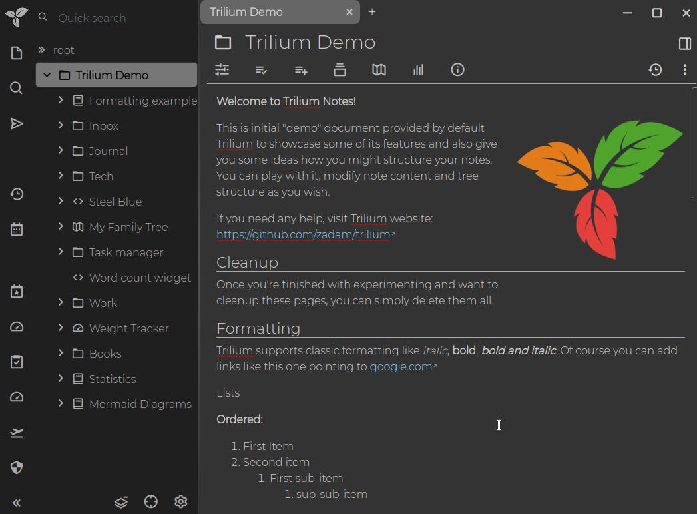
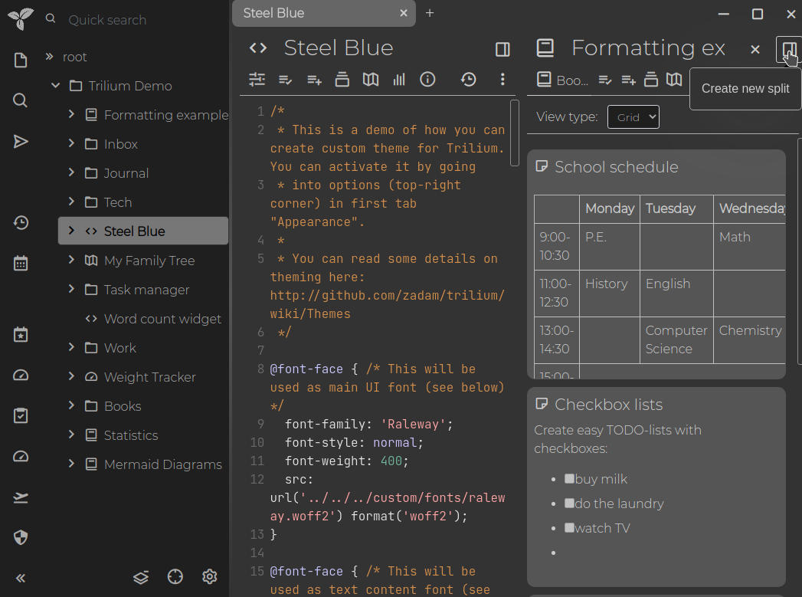
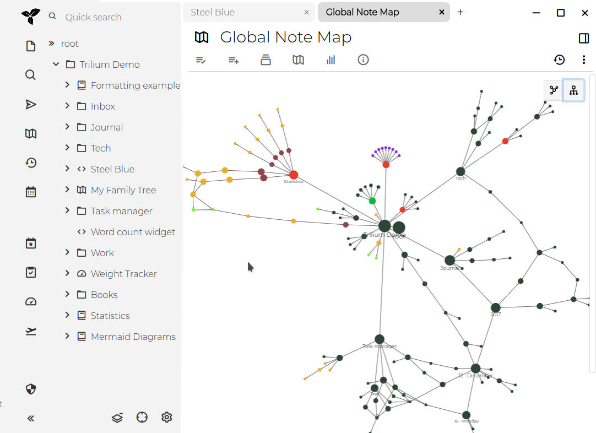
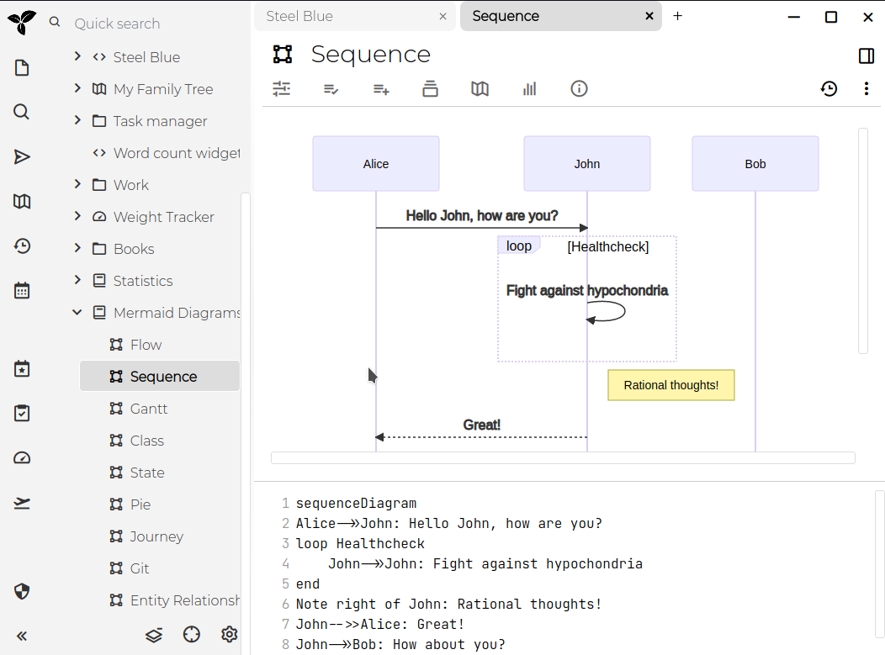
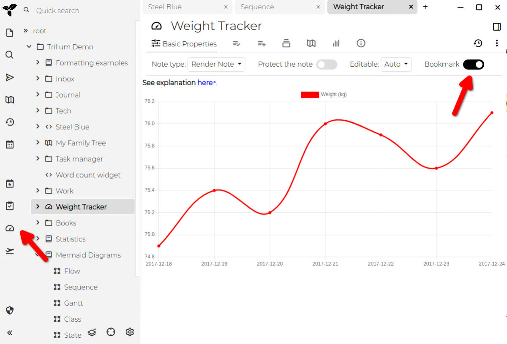

# v0.48
0.48 是一个大版本，包含许多变更，其中一些是破坏性变更：

## 前端重大重构



*   右侧面板已移除，大部分小组件已移至笔记标题下方新的功能区样式小组件中
    *   右侧面板仍可为脚本激活
*   Trilium 有了新图标（可能还会有进一步的颜色调整）

## 垂直分屏窗口

<figure class="image"></figure>

## 链接图重新实现

现在也支持笔记的层级视图：

<figure class="image"></figure>

## Mermaid 图表

感谢 [@abitofevrything](https://github.com/abitofevrything) 的贡献！

<figure class="image"></figure>

## 基本书签支持

<figure class="image"></figure>

## 其他变更

*   后端的持久化/实体层进行了大规模重构——"repository" 与笔记缓存统一，应为许多操作带来性能提升
*   搜索和 SQL 查询笔记现在默认不创建"已保存"的笔记
*   添加了下划线标题样式并将其设为默认
*   将 CKEditor 更新至 30.0.0

## 迁移

### 备份恢复

Trilium v0.48 目前处于 beta 阶段，可能包含严重 bug。

在迁移到 0.48 之前，Trilium 会自动备份到 `~/trilium-data/backup/backup-before-migration.db`。如遇问题，可参照本指南恢复此备份：[https://github.com/zadam/trilium/wiki/Backup#restoring-backup](https://github.com/zadam/trilium/wiki/Backup#restoring-backup)

### 仅支持从 0.47.X 直接升级

仅支持从 0.47.X 直接升级到 0.48。如果要从更早的版本升级，需要先升级到 0.47.X，然后再升级到 0.48。这是由于大规模后端重构破坏了旧的迁移脚本。

### 所有后端脚本笔记应避免使用 async

旧版本中，由于 SQLite 驱动的原因，后端操作使用 async/await。但 Trilium 最近迁移到了同步（且快得多）的 `better-sqlite3`。因此，包裹在事务中的后端脚本笔记应转换为同步版本。

例如，旧脚本如下所示：

```
const todayDateStr = api.formatDateISO(new Date());

const todayNote = await api.runOnBackend(async todayDateStr => {
    const dateNote = await api.getDayNote(todayDateStr);
    
    ({note: logNote} = await api.createNote(dateNote.noteId, 'log'));
}, [todayDateStr]);

api.activateNote(todayNote.noteId);
```

所有 `await`（以及 `async`）应从后端代码中消失，但从前端调用后端时应保留（那仍然是异步的）：

```
const todayDateStr = api.formatDateISO(new Date());

const todayNote = await api.runOnBackend(todayDateStr => {
    const dateNote = api.getDayNote(todayDateStr);
    
    ({note: logNote} = api.createNote(dateNote.noteId, 'log'));
}, [todayDateStr]);

api.activateNote(todayNote.noteId);
```

### 迁移自定义主题

由于重构，你可能需要调整自定义主题——请查看[默认主题](https://github.com/zadam/trilium/blob/master/src/public/stylesheets/theme-light.css)中可用 CSS 变量的修改列表。如果你的主题还使用了 CSS 选择器，那么这些可能也需要重写。

主题通过 `#appTheme` 标签标注，此前该标签可以包含值但不是必须的——从本版本起值变为必需，因此请将标签定义为例如 `#appTheme=my-theme-name`。

此外，CSS 主题的加载方式与之前不同——以前所有主题在启动时加载，通过激活的 CSS 类决定哪个生效。主题会像这样添加前缀：

```
body.theme-steel-blue {
    --main-font-family: 'Raleway' !important;
    --main-font-size: normal;

    --tree-font-family: inherit;
    --tree-font-size: normal;
	...
}

body.theme-steel-blue .note-detail-editable-text, body.theme-steel-blue .note-detail-readonly-text {
    font-size: 120%;
}
```

不再需要这种前缀（也不再起作用）。请像这样移除前缀：

```
:root {
    --main-font-family: 'Raleway';
    --main-font-size: normal;
    
    --tree-font-family: 'Raleway';
    --tree-font-size: normal;
    ...
}

body .note-detail-editable-text, body .note-detail-readonly-text {
    font-size: 120%;
}
```