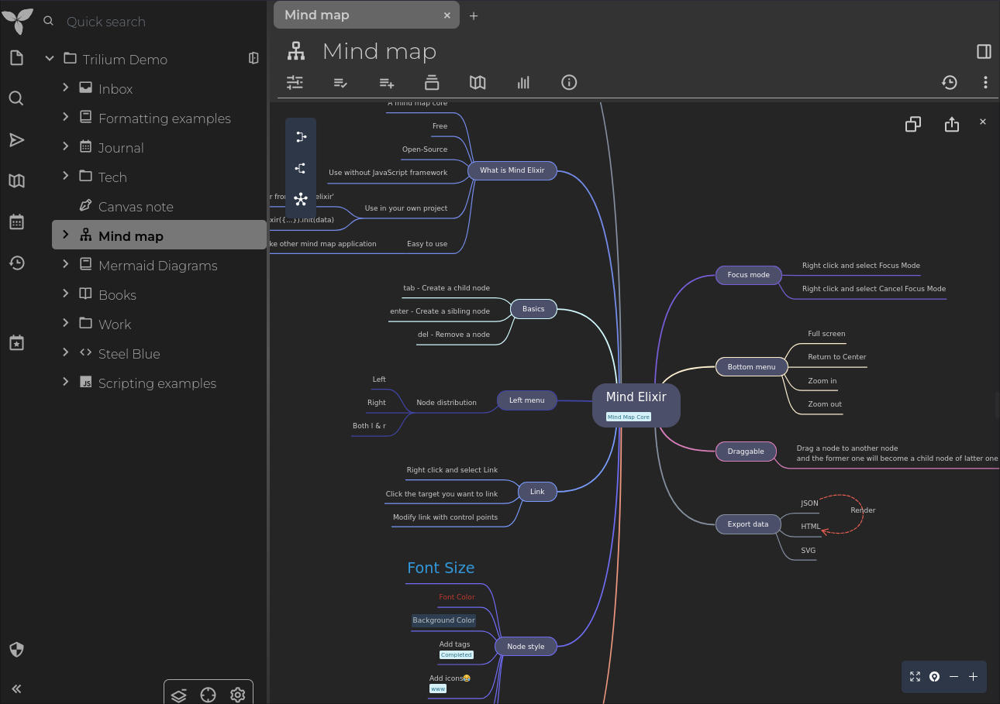

# v0.90.5-beta
此版本带来了一些使用体验上的改进，以及错误修复。然而，最主要的亮点是增加了对本地化的支持以及一种新的笔记类型。

## 🌍 国际化

得益于 `@Nriver` 的努力，已添加对国际化的初步支持。更具体地说，以下语言现在已有部分翻译：

*   西班牙语，由 `@hasecilu` 提供
*   中文，由 `@Nriver` 提供
*   罗马尼亚语。

请注意，目前仅客户端已完成翻译，在应用程序完全翻译之前仍有大量任务需要处理。

## 💡 新笔记类型：思维导图

思维导图通常是快速记录想法和与团队进行头脑风暴的方法。TriliumNext 借助开源库 [Mind Elixir](https://mind-elixir.com/) 引入了这种新的笔记类型。

请注意，该集成仍处于初期阶段，因此在稳定之前可能存在错误和功能缺失。该库本身支持相当多的功能，但尚未在 Trilium 中实现：使用 KaTeX 的数学表达式、图片、链接。如果用户有需求，这些功能可能会在后续实现。

<figure class="image"></figure>

> **注意**：为使该笔记类型完全正常工作（例如共享笔记），如果您正在使用服务器实例，最好也一并更新服务器实例。

## ⚙️ 构建

内部构建工具已更新，带来以下变化：

*   对于 macOS 用户，现在也有了 `.dmg` 安装方式。`@JYC333`
    *   还有一个可用于 macOS 的 ARM 原生版本，但由于缺少公证（以绕过“Trilium Notes.app”已损坏的错误），需要[额外步骤才能运行](https://github.com/TriliumNext/Notes/issues/329)。
*   对于 Windows 和 Linux，我们现在也有了 `amd64` 构建。
    *   请注意，由于缺乏设备，这些版本未经过积极测试，因此请随时提出您可能遇到的任何问题。

在 Docker 方面，由 `@perfectrain` [恢复了基于 Alpine 的 amd64 Docker 容器](https://github.com/TriliumNext/Notes/pull/366)。

### 🐞 错误修复

*   [v0.90.4 Docker 不读取环境变量中的 USER\_UID 和 USER\_GID](https://github.com/TriliumNext/Notes/issues/331)
*   [Android 手机上无效的 CSRF 令牌](https://github.com/TriliumNext/Notes/issues/318)
*   [列表中多余的间距](https://github.com/TriliumNext/Notes/issues/341)
*   [scrollbar-color 使滚动条显示为原生样式](https://github.com/TriliumNext/Notes/issues/350)
*   Firefox 上滚动条不可见
*   [笔记标题文本框边框问题](https://github.com/TriliumNext/Notes/issues/358)
*   [从块编辑器点击 `Include Note` 时焦点未设置到输入框](https://github.com/TriliumNext/Notes/issues/365)
*   [修复查找小组件的一个错误](https://github.com/TriliumNext/Notes/pull/377)，由 `@SiriusXT` 提供
*   [启动 Trilium 时出现“主进程中发生 JavaScript 错误”](https://github.com/TriliumNext/Notes/issues/368)（改进了错误处理）。
*   [在只读模式下点击内部 trilium 链接时笔记工具提示未被移除](https://github.com/TriliumNext/Notes/issues/375)
*   [如果点击/右键点击启动栏中打开笔记的其他按钮，日历下拉菜单不会关闭](https://github.com/TriliumNext/Notes/issues/384)

### ✨ 改进

*   [改进了启动栏中的日历按钮](https://github.com/TriliumNext/Notes/issues/374)，添加了对更便捷的月份和年份选择的支持。
*   [使每周第一天可配置](https://github.com/TriliumNext/Notes/issues/247)（支持周日和周一）
    *   可在 选项 → 外观 → 本地化 → 每周第一天 中调整。
    *   该选项与服务器同步，客户端会立即更新。
*   移除了硬编码的库，如 FancyTree 和 Bootstrap。这将允许我们后续升级到最新版本。`@JYC333`
*   [在 Web 版本中隐藏 Electron 特有的设置](https://github.com/TriliumNext/Notes/issues/345)
*   [添加一个开关以将当前笔记提升为模板](https://github.com/TriliumNext/Notes/issues/348)
*   在选项中禁用共享开关
*   [从任务栏打开新窗口](https://github.com/TriliumNext/Notes/pull/373)，由 `@SiriusXT` 提供
*   按 F2 编辑分支前缀现在仅在笔记树中生效，以避免与思维导图等其他交互元素产生问题，同时也因为该选项本身并非最常用的功能，不需要全局快捷键。

## 新贡献者

*   [@JYC333](https://github.com/JYC333) 在 [#294](https://github.com/TriliumNext/Notes/pull/294) 中做出了首次贡献
*   [@hasecilu](https://github.com/hasecilu) 在 [#349](https://github.com/TriliumNext/Notes/pull/349) 中做出了首次贡献
*   [@SiriusXT](https://github.com/SiriusXT) 在 [#377](https://github.com/TriliumNext/Notes/pull/377) 中做出了首次贡献