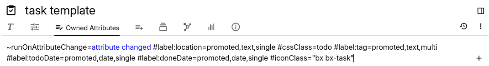

# 属性
<figure class="image"></figure>

在 Trilium 中，属性是分配给笔记的键值对，提供额外的元数据或功能。属性主要有两种类型：

1.  <a class="reference-link" href="Attributes/Labels.md">标签</a>可用于多种目的，例如存储元数据或配置笔记的行为。标签也可被搜索，从而增强笔记检索能力。
    
    有关更多信息（包括预定义标签），请参阅 <a class="reference-link" href="Attributes/Labels.md">标签</a>。
2.  <a class="reference-link" href="Attributes/Relations.md">关系</a>定义笔记之间的连接，类似于链接。这些可用于元数据和脚本目的。
    
    有关更多信息（包括预定义关系列表），请参阅 <a class="reference-link" href="Attributes/Relations.md">关系</a>。

这些属性在组织、分类和增强笔记功能方面发挥着至关重要的作用。

## 属性的类型

从概念上讲，有两种类型的属性（同时适用于标签和关系）：

1.  **系统属性**  
    顾名思义，这些属性具有特殊含义，因为它们由 Trilium 解释。例如，`color` 属性将更改笔记在<a class="reference-link" href="../Basic%20Concepts%20and%20Features/UI%20Elements/Note%20Tree.md">笔记树</a>和链接中显示的颜色，而 `iconClass` 将更改笔记的图标。
2.  **用户定义属性**  
    这些是用户可使用的自由形式的标签或关系。它们可以纯粹用于分类目的（特别是与<a class="reference-link" href="../Basic%20Concepts%20and%20Features/Navigation/Search.md">搜索</a>结合使用时），也可以通过使用<a class="reference-link" href="../Scripting.md">脚本</a>赋予其含义。

在实践中，Trilium 不直接区分属性是系统属性还是用户定义属性。如果标签或关系与某个内置名称匹配（例如前述的 `iconClass`），则被视为系统属性。在创建<a class="reference-link" href="Attributes/Promoted%20Attributes.md">提升属性</a>时请记住这一点，以免意外更改系统属性（除非有意为之）。

## 查看属性列表

当前笔记的标签和关系都显示在：

*   <a class="reference-link" href="../Basic%20Concepts%20and%20Features/UI%20Elements/Right%20Sidebar.md">右侧边栏</a>中的<a class="reference-link" href="../Basic%20Concepts%20and%20Features/UI%20Elements/Right%20Sidebar/Attributes%20tab.md">属性选项卡</a>，以网格状视图显示。
*   更高级的选项，在<a class="reference-link" href="../Basic%20Concepts%20and%20Features/UI%20Elements/Status%20bar.md">状态栏</a> → （_属性_）中，属性以文本方式显示，便于复制或进行批量修改。
    *   在属性列表中，标签以 `#` 字符为前缀，而关系以 `~` 字符为前缀。

## 属性定义和提升属性

<a class="reference-link" href="Attributes/Promoted%20Attributes.md">提升属性</a>为属性创建类似表单的编辑体验，从而轻松增强属性的组织和管理

## 多重性

Trilium 中的属性可以是“多值的”，这意味着多个同名属性可以共存。这可以与<a class="reference-link" href="Attributes/Promoted%20Attributes.md">提升属性</a>结合使用，以便轻松添加它们。

## 属性继承

Trilium 支持属性继承，允许子笔记从其父笔记继承属性。有关更多信息，请参阅<a class="reference-link" href="Attributes/Attribute%20Inheritance.md">属性继承</a>。