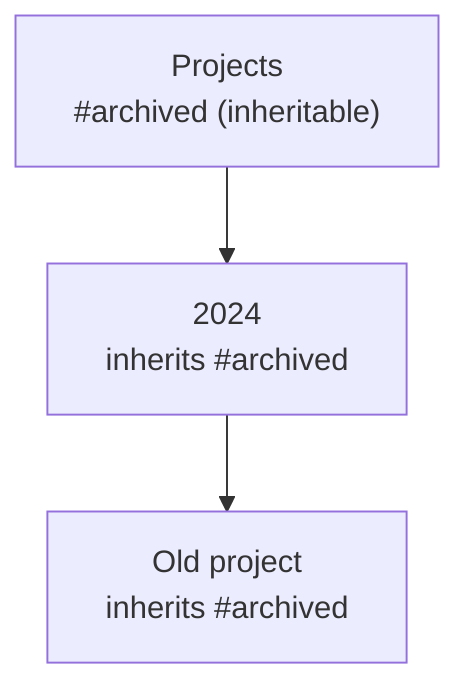
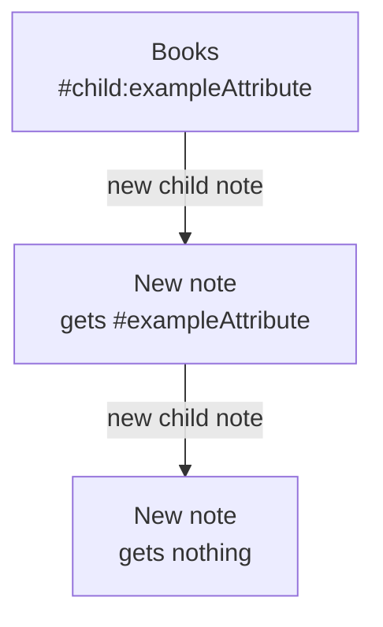

# 属性继承
继承是指让一个[标签](Labels.md)或[关系](Relations.md)在多个笔记之间共享的过程，通常是在父子关系中（如果使用模板，则可以在任何位置）。

## 标准继承

在 Trilium 中，如果属性设置了 `isInheritable` 标志为 `true`，则子笔记可以自动继承该属性。这意味着该属性（键值对）会应用于该笔记及其所有后代。

要使属性可继承，只需使用<a class="reference-link" href="Labels.md">标签</a>或<a class="reference-link" href="Relations.md">关系</a>的可视化编辑器。或者，也可以手动定义属性，当可继承时，`#myLabel=value` 会变为 `#myLabel(inheritable)=value`。

例如，可以将 `archived` 标签设置为可继承，通过在顶层应用此标签，可以在搜索和其他对话框中隐藏整个笔记子树。

标准继承强制一个笔记的所有子笔记（以及子笔记的子笔记）都拥有该特定标签或关系。如果需要有某些笔记不继承其中某个标签，则需要改用_复制继承_或_模板继承_。

## 复制继承

复制继承与标准继承的区别在于属性名称中使用了 `child:` 前缀。该前缀会使新的子笔记自动从父笔记接收特定属性。这些属性独立于父笔记，即使笔记被移动到其他地方也会保留。

如果父笔记拥有标签 `#child:exampleAttribute`，则所有新创建的子笔记（一层深度）将继承 `#exampleAttribute` 标签。这对于为特定区域中的笔记设置默认属性非常有用。

同样，对于关系，使用 `~child:myRelation`。

由于其设计方式，复制继承无法在层级结构中无限级联。对于该用例，请考虑使用标准继承或模板。

### 链式继承

可以跨多个深度层级定义标签。例如，将 `#child:child:child:foo` 应用于根笔记会创建：

*   第一层子笔记上的 `#child:child:foo`。
*   第二层子笔记上的 `#child:foo`。
*   第三层子笔记上的 `#foo`。

同样，如果处理的是关系，请使用 `~child:child:child:foo`。

请注意，与简单的复制继承一样，更改不会追溯应用于层级结构中已有的笔记，只会应用于新创建的笔记。

## 模板继承

属性也可以从<a class="reference-link" href="../Templates.md">模板</a>继承。当使用模板创建新笔记时，它会继承该模板中定义的属性。这对于在遵循相似结构或功能的笔记之间保持一致性特别有用。