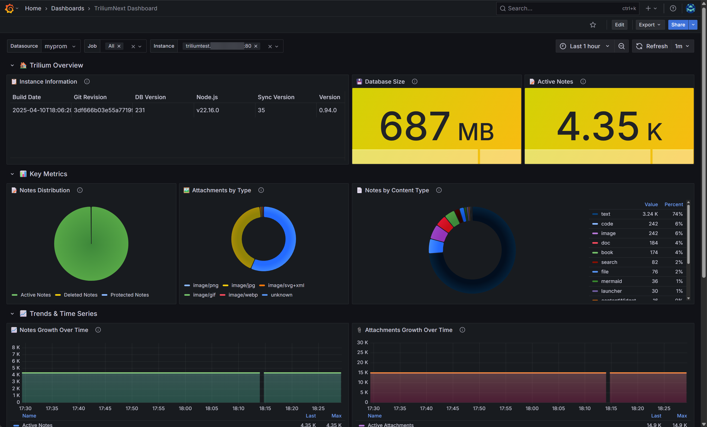

# 指标

Trilium 指标 API 提供关于你的 Trilium 实例的全面监控数据，专为 Prometheus 等外部监控系统设计。

## 端点

*   **URL**：`/etapi/metrics`
*   **方法**：`GET`
*   **身份验证**：需要 ETAPI 令牌
*   **默认格式**：Prometheus 文本格式

## 身份验证

你需要一个 ETAPI 令牌来访问指标端点。通过以下方式获取：

```
# Get an ETAPI token
curl -X POST http://localhost:8080/etapi/auth/login \
  -H "Content-Type: application/json" \
  -d '{"password": "your_password"}'

```

## 用法

=== "Prometheus 格式（默认）"

    ```
    curl -H "Authorization: YOUR_ETAPI_TOKEN" \
      http://localhost:8080/etapi/metrics

    ```

    以 Prometheus 文本格式返回指标：

    ```
    # HELP trilium_info Trilium instance information
    # TYPE trilium_info gauge
    trilium_info{version="0.91.6",db_version="231",node_version="v18.17.0"} 1 1701432000

    # HELP trilium_notes_total Total number of notes including deleted
    # TYPE trilium_notes_total gauge
    trilium_notes_total 1234 1701432000
    ```

=== "JSON 格式"

    ```
    curl -H "Authorization: YOUR_ETAPI_TOKEN" \
      "http://localhost:8080/etapi/metrics?format=json"

    ```

    以 JSON 格式返回详细指标，用于调试或自定义集成。

## 可用指标

### 实例信息

*   `trilium_info` - 带标签的版本和构建信息

### 数据库指标

*   `trilium_notes_total` - 笔记总数（包括已删除）
*   `trilium_notes_deleted` - 已删除笔记数
*   `trilium_notes_active` - 活动笔记数
*   `trilium_notes_protected` - 受保护笔记数
*   `trilium_attachments_total` - 附件总数
*   `trilium_attachments_active` - 活动附件数
*   `trilium_revisions_total` - 笔记修订总数
*   `trilium_branches_total` - 活动分支数
*   `trilium_attributes_total` - 活动属性数
*   `trilium_blobs_total` - blob 记录总数
*   `trilium_etapi_tokens_total` - 活动 ETAPI 令牌数
*   `trilium_embeddings_total` - 笔记嵌入（如可用）

### 分类指标

*   `trilium_notes_by_type{type="text|code|image|file"}` - 按类型统计的笔记
*   `trilium_attachments_by_type{mime_type="..."}` - 按 MIME 类型统计的附件

### 统计信息

*   `trilium_database_size_bytes` - 数据库大小（字节）
*   `trilium_oldest_note_timestamp` - 最旧笔记的时间戳
*   `trilium_newest_note_timestamp` - 最新笔记的时间戳
*   `trilium_last_modified_timestamp` - 最后修改时间戳

## Prometheus 配置

添加到你的 `prometheus.yml`：

```
scrape_configs:
  - job_name: 'trilium'
    static_configs:
      - targets: ['localhost:8080']
    metrics_path: '/etapi/metrics'
    bearer_token: 'YOUR_ETAPI_TOKEN'
    scrape_interval: 30s

```

## 错误响应

*   `400` - 无效的 format 参数
*   `401` - 缺少或无效的 ETAPI 令牌
*   `500` - 内部服务器错误

## Grafana 仪表板

<figure class="image"></figure>

你也可以使用为 Trilium 创建的 Grafana 仪表板：从 <a class="reference-link" href="Metrics/grafana-dashboard.json">grafana-dashboard.json</a> 获取 JSON，并通过 _仪表板_ → _新建_ → _导入_ 在 Grafana 中导入：粘贴 JSON 并按下 _加载_。