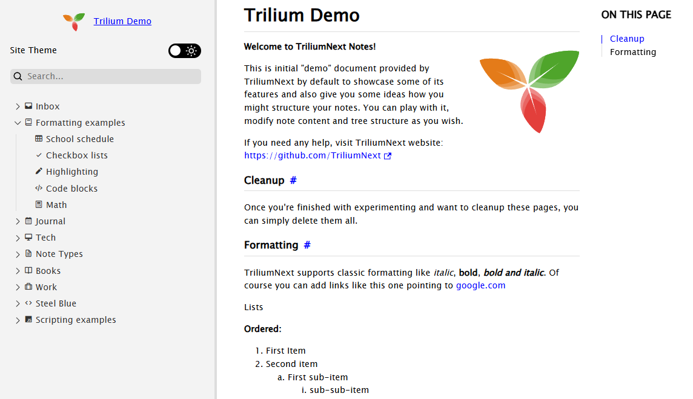
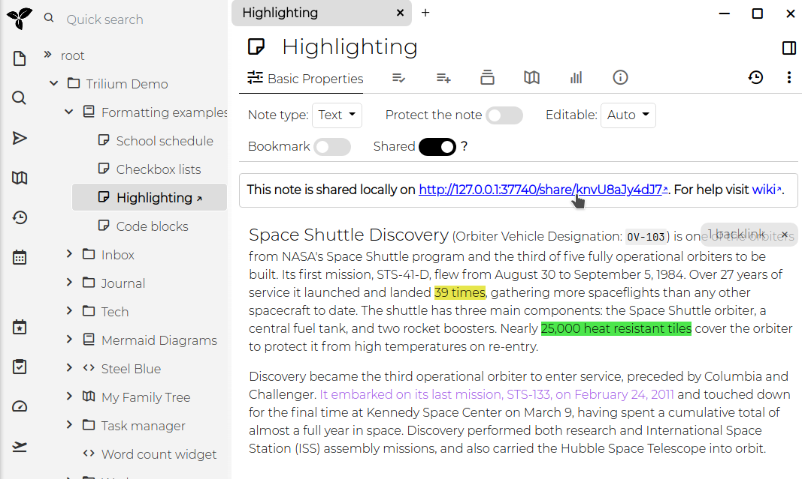

# 共享
Trilium 允许你将选定的笔记作为**可公开访问**的只读文档进行共享。此功能特别适用于直接从你的 Trilium 笔记中发布内容，使其可在网上被他人访问。

<figure class="image"></figure>

## 功能、交互与限制

*   按笔记标题搜索。
*   浅色和深色模式，默认跟随访客的系统设置，页面打开期间也是如此。访客可以通过导航窗格顶部的按钮选择*浅色*、*深色*或*系统*；该选择会被浏览器记住。
*   在宽屏幕上采用居中布局，导航树和目录分别位于内容两侧；在窄屏幕上采用移动端友好的布局。在窄屏幕上，导航树从页眉的菜单按钮滑入，并在其条目下方列出当前页面的标题（对于树中未显示的页面，则显示在窗格顶部）。
*   可折叠的树，使用与应用程序相同的笔记图标。当访客在站点页面之间移动时，它会保留访客展开的区块及其滚动位置，并显示当前笔记。
*   可自定义的徽标。
*   快速导航按钮（上一篇和下一篇笔记）。
*   使用 `#subtreeHidden` 在树中隐藏其子笔记的笔记（例如<a class="reference-link" href="../Collections/Kanban%20Board.md">看板</a>）会显示一个计数徽章，而不是列出它们。这些子笔记之一的页面仅在其父笔记下方显示该子笔记，上一篇和下一篇按钮会跳过它们。
*   文本或代码笔记的子页面会像在应用程序中一样，以卡片形式显示在其内容下方。每张卡片显示子页面的图标及其文本开头（或其 `#shareDescription`），或者，对于没有文本的子页面，则链接到其自身的第一批子页面。可以使用 `#hideChildrenOverview` 隐藏这些卡片。
*   显示笔记的最后更新日期，以应用程序的语言书写。
*   用应用程序的语言及其文本方向标记页面，并用笔记自身的[内容语言](../Note%20Types/Text/Content%20language%20%26%20Right-to-left%20support.md)标记笔记内容，以供屏幕阅读器和从右到左的文本使用。

### 按笔记类型

<table class="ck-table-resized">
    <colgroup>
        <col style="width:19.92%;">
        <col style="width:41.66%;">
        <col style="width:38.42%;">
    </colgroup>
    <thead>
        <tr>
            <th>&nbsp;</th>
            <th>支持的功能</th>
            <th>限制</th>
        </tr>
    </thead>
    <tbody>
        <tr>
            <th><a class="reference-link" href="../Note%20Types/Text.md">文本</a></th>
            <td><ul><li>目录，保留标题的行内格式，例如代码或粗体文本。</li><li>每个标题旁边有一个链接，当指针悬停在标题上时显示。点击它会在浏览器的地址栏中显示该章节的地址并复制它，以便共享指向该章节的链接。</li><li>代码块的语法高亮，使用为每个块选择的语言，并采用 VS Code 浅色或深色主题的颜色，跟随页面的模式。对于“自动检测”的块，语言会在<a class="reference-link" href="../Basic%20Concepts%20and%20Features/UI%20Elements/Options.md">选项</a> → <em>代码笔记</em>中启用的语言之间进行猜测；未在其中启用的语言不会被高亮。</li><li>每个代码块右上角有一个按钮，当指针悬停在块上时显示，用于复制其代码。通过纯 HTTP 打开的页面没有此按钮，因为浏览器仅允许在安全（HTTPS）页面上复制到剪贴板。</li><li>数学公式的渲染。</li><li><a href="../Note%20Types/Text/Include%20Note.md">包含笔记</a>（仅当被包含的笔记也被共享时）。</li><li>绘图画布，以其自身尺寸显示为图片。</li><li>代码块中的 Mermaid 图表，以页面的浅色或深色模式绘制，并在访客切换模式时重新绘制。</li></ul></td>
            <td>&nbsp;</td>
        </tr>
        <tr>
            <th><a class="reference-link" href="../Note%20Types/Code.md">代码</a></th>
            <td><ul><li>语法高亮，使用笔记的语言和 VS Code 浅色或深色主题的颜色，跟随页面的模式。未在<a class="reference-link" href="../Basic%20Concepts%20and%20Features/UI%20Elements/Options.md">选项</a>&nbsp;→ <em>代码笔记</em>中启用的语言不会被高亮。除非在同一部分中关闭了<em>行号</em>，否则会对行进行编号。</li></ul></td>
            <td>&nbsp;</td>
        </tr>
        <tr>
            <th><a class="reference-link" href="../Note%20Types/Saved%20Search.md">保存的搜索</a></th>
            <td>不支持。</td>
            <td>&nbsp;</td>
        </tr>
        <tr>
            <th><a class="reference-link" href="../Note%20Types/Relation%20Map.md">关系图</a></th>
            <td>不支持。</td>
            <td>&nbsp;</td>
        </tr>
        <tr>
            <th><a class="reference-link" href="../Note%20Types/Note%20Map.md">笔记图</a></th>
            <td>不支持。</td>
            <td>&nbsp;</td>
        </tr>
        <tr>
            <th><a class="reference-link" href="../Note%20Types/Render%20Note.md">渲染笔记</a></th>
            <td>不支持。</td>
            <td>&nbsp;</td>
        </tr>
        <tr>
            <th><a class="reference-link" href="../Collections.md">集合</a></th>
            <td><ul><li>子笔记以卡片形式显示，或者当集合的视图类型为<em>列表</em>时以列表形式显示。每个都显示其图标及其文本开头（或其 <code>#shareDescription</code>），或者，对于没有文本的子笔记，则链接到其自身的第一批子笔记。</li></ul></td>
            <td><ul><li>日历、表格、看板、地理地图、仪表板和演示视图类型会像在应用程序中一样显示，但为只读。</li></ul></td>
        </tr>
        <tr>
            <th><a class="reference-link" href="../Note%20Types/Mermaid%20Diagrams.md">Mermaid 图表</a></th>
            <td><ul><li>图表以页面的浅色或深色模式绘制，并在访客切换模式时重新绘制。在禁用 JavaScript 的浏览器中，会改为显示笔记上次编辑时保存的图像，并且可以在其下方展开图表的源代码。</li><li>图表填满页面，可以使用其底部角落的 <span class="tn-icon bx bx-minus-circle"></span> 和 <span class="tn-icon bx bx-plus-circle"></span> 按钮或鼠标滚轮进行缩放，缩放范围在其适应尺寸的 50% 到 1000% 之间，在触摸屏上可通过捏合缩放。点击按钮之间的百分比，或双击图表，会再次完整显示它。可以通过拖动来平移图表。</li></ul></td>
            <td>&nbsp;</td>
        </tr>
        <tr>
            <th><a class="reference-link" href="../Note%20Types/Canvas.md">画布</a></th>
            <td><ul><li>图表以矢量图像形式显示。</li></ul></td>
            <td><ul><li>不支持进一步交互。</li></ul></td>
        </tr>
        <tr>
            <th><a class="reference-link" href="../Note%20Types/Web%20View.md">网页视图</a></th>
            <td>不支持。</td>
            <td>&nbsp;</td>
        </tr>
        <tr>
            <th><a class="reference-link" href="../Note%20Types/Mind%20Map.md">思维导图</a></th>
            <td>图表以矢量图像形式显示。</td>
            <td><ul><li>不支持进一步交互。</li></ul></td>
        </tr>
        <tr>
            <th><a class="reference-link" href="../Collections/Geo%20Map.md">地理地图</a></th>
            <td>不支持。</td>
            <td>&nbsp;</td>
        </tr>
        <tr>
            <th><a class="reference-link" href="../Note%20Types/File.md">文件</a></th>
            <td>基本交互（下载文件）。</td>
            <td><ul><li>不支持进一步交互。</li></ul></td>
        </tr>
    </tbody>
</table>

虽然共享功能很强大，但它有一些限制：

*   **静态笔记树**
*   **受保护的笔记**：无法共享。
*   **包含笔记**：不支持。

其中一些限制可能会在未来的更新中得到解决。

## 前提条件

要使用共享功能，你必须拥有 Trilium 的<a class="reference-link" href="../Installation%20%26%20Setup/Server%20Installation.md">服务器安装</a>。这是必要的，因为笔记将从服务器托管。

## 共享笔记

1.  **启用共享**：要共享笔记，请在笔记界面中切换 `Shared` 开关。启用共享后，会出现一个 URL，你可以点击它来访问共享笔记。
    
    
2.  **访问共享笔记**：提供的链接将在你的浏览器中打开该笔记。如果你的服务器未配置公共 IP，则该 URL 将指向 `localhost (127.0.0.1)`。

## 共享笔记子树

当你共享一个笔记时，你实际上共享了它下面的整个笔记子树。如果该笔记有子笔记，它们也会被包含在共享内容中。例如，共享“Formatting”子树将显示一个页面，其中包含用于浏览该子树内所有笔记的基本导航。

## 查看和管理共享笔记

你可以通过点击<a class="reference-link" href="../Basic%20Concepts%20and%20Features/UI%20Elements/Global%20menu.md">全局菜单</a>中的*高级* → *共享笔记*来查看所有共享笔记的列表。这允许你管理和浏览你已公开的所有笔记。

## 安全注意事项

*   共享笔记发布在开放的互联网上，除非笔记受密码保护，否则任何拥有 URL 的人都可以访问。
*   URL 的随机性并不提供安全性，因此切勿通过此功能共享敏感信息，这一点至关重要。
*   Trilium 会采取预防措施来保护你公开共享的实例，防止非共享笔记的信息泄露，包括打开一个单独的只读连接来访问<a class="reference-link" href="Database.md">数据库</a>。根据你的威胁模型，使用<a class="reference-link" href="Sharing/Exporting%20static%20HTML%20for%20web%20publishing.md">导出静态 HTML 用于 Web 发布</a>并使用经过实战检验的 Web 服务器（如 Nginx 或 Apache）来提供静态内容可能更有意义。

### 密码保护

要使用用户名和密码保护共享笔记，你可以使用 `#shareCredentials` 属性。将此标签添加到笔记中，格式为 `#shareCredentials="username:password"`。要保护整个子树，请确保该标签是[可继承的](Attributes/Attribute%20Inheritance.md)。

## 高级共享选项

### 自定义共享笔记的外观

默认设计应该是一个良好的起点，但你可以使用自己的 CSS 进行自定义：

*   **自定义 CSS**：通过向笔记添加 `~shareCss` 关系，将 CSS <a class="reference-link" href="../Note%20Types/Code.md">代码</a>笔记链接到共享页面。如果你希望此样式应用于整个子树，请使该标签可继承。你可以通过添加 `#shareHiddenFromTree` 标签来从树导航中隐藏 CSS 代码笔记。
*   **省略默认 CSS**：对于大量的样式更改，请使用 `#shareOmitDefaultCss` 标签以避免与 Trilium 的[默认样式表](../Basic%20Concepts%20and%20Features/Themes.md)冲突。

### 添加 JavaScript

你可以使用 `~shareJs` 关系将自定义 JavaScript 注入共享笔记。这允许你访问笔记属性或使用 `fetchNote()` API 遍历笔记树，该 API 根据笔记的 ID 检索笔记数据。

### 添加自定义 HTML

你可以使用 `~shareHtml` 关系将自定义 HTML 片段注入共享页面的特定位置。HTML 笔记应包含你要注入的原始 HTML 内容，你可以通过向 HTML 片段笔记本身添加 `#shareHtmlLocation` 标签来控制其显示位置。

`#shareHtmlLocation` 标签接受格式为 `location:position` 的值：

*   **位置**：`head`、`body`、`content`
*   **方位**：`start`、`end`

例如：

*   `#shareHtmlLocation=head:start` - 在 `<head>` 部分的开头注入 HTML
*   `#shareHtmlLocation=head:end` - 在 `<head>` 部分的末尾注入 HTML（默认）
*   `#shareHtmlLocation=body:start` - 在 `<body>` 部分的开头注入 HTML
*   `#shareHtmlLocation=content:start` - 在内容区域的开头注入 HTML
*   `#shareHtmlLocation=content:end` - 在内容区域的末尾注入 HTML

如果未指定位置，则默认将 HTML 注入到 `content:end`。

示例：

```javascript
const currentNote = await fetchNote();
const parentNote = await fetchNote(currentNote.parentNoteIds[0]);

for (const attr of parentNote.attributes) {
    console.log(attr.type, attr.name, attr.value);
}
```

### 自定义共享模板

要完全重新设计共享，可以创建或使用现有的[自定义共享模板](Sharing/Custom%20share%20template.md)。

### 创建人类可读的 URL 别名

共享笔记通常具有类似 `http://domain.tld/share/knvU8aJy4dJ7` 的 URL，其中最后一部分是笔记的 ID。你可以通过向单个笔记添加 `#shareAlias` 标签（例如 `#shareAlias=highlighting`）来使这些 URL 更加用户友好。这会将 URL 更改为 `http://domain.tld/share/highlighting`。带有笔记 ID 的 URL 仍然有效，并会重定向到别名。

**重要**：

1.  确保别名是唯一的。
2.  不支持在别名中使用斜杠（`/`）来创建子路径。

> [!TIP]
> *   要轻松识别没有共享别名的页面，请使用 `#!shareAlias` 运行<a class="reference-link" href="../Basic%20Concepts%20and%20Features/Navigation/Search.md">搜索</a>。
> *   为了能够更快地输入共享别名，请考虑使用<a class="reference-link" href="Attributes/Promoted%20Attributes.md">提升属性</a>（例如 `#label:shareAlias(inheritable)="promoted,alias=Slug,single,text"`）。

### 设置自定义 favicon

要自定义共享页面的 favicon，请创建一个 `~shareFavicon` 关系，指向包含 favicon 的文件笔记（例如，`.ico` 格式）。

### 将笔记共享为根

你可以通过添加 `#shareRoot` 标签来指定特定笔记或文件夹作为共享内容的根。访问 `[http://domain.tld/share](http://domain/share)` 时将链接到该笔记，从而更容易将 Trilium 用作一个功能完备的网站。

> [!TIP]
> 考虑将其与 `#shareIndex` 标签结合使用，该标签将显示所有共享笔记的列表。

### 显示共享笔记的索引

访问共享时，子笔记将显示在左侧的树中。但由于可以共享多个笔记树，因此显示所有不同共享树的列表可能会很有用。

为此，请创建一个共享文本笔记并应用 `shareIndex` 标签。查看时，共享根列表将显示在笔记底部。

### 链接到外部网站

有时，在共享笔记旁边包含指向外部网站的链接很有用——例如在共享导航或索引中。为此，请向笔记添加 `#shareExternalLink` 标签，并将目标 URL 作为其值（例如 `#shareExternalLink="https://example.com"`）。

任何指向此笔记的链接随后都会重定向到外部网站并在新的浏览器标签页中打开，而不是打开笔记自身的共享页面。通过其 ID 打开笔记的共享 URL 也会重定向到外部网站。这适用于：

*   `#shareIndex` 标签生成的列表；
*   共享站点的导航树；
*   父笔记下方显示的“子页面”列表；
*   其他共享笔记中指向此笔记的行内链接。

URL 必须是绝对地址并包含协议（例如 `https://`）。

> [!NOTE]
> 该笔记仍然存在于共享树中，其自身页面仍可通过其直接 URL 访问——该标签仅改变指向它的链接的行为。

## 属性参考

<table class="ck-table-resized">
    <colgroup>
        <col style="width:18.38%;">
        <col style="width:81.62%;">
    </colgroup>
    <thead>
        <tr>
            <th>属性</th>
            <th>描述</th>
        </tr>
    </thead>
    <tbody>
        <tr>
            <td><code>#shareHiddenFromTree</code></td>
            <td>此笔记从左侧导航树、其父笔记的子页面列表、共享笔记图和共享搜索中隐藏，但仍可通过其 URL 访问</td>
        </tr>
        <tr>
            <td><code>#shareExternalLink</code></td>
            <td>当链接指向此笔记时（来自共享索引、子页面列表或其他共享笔记中的行内链接），它会在新标签页中重定向到给定的外部 URL，而不是笔记的共享页面。值为绝对 URL，例如 <code>https://example.com</code>。</td>
        </tr>
        <tr>
            <td><code>#shareAlias</code></td>
            <td>定义一个别名，使用该别名可在 <code>https://your_trilium_host/share/[your_alias]</code> 下访问该笔记</td>
        </tr>
        <tr>
            <td><code>#shareOmitDefaultCss</code></td>
            <td>将省略默认共享页面 CSS。当你进行大量样式更改时使用。</td>
        </tr>
        <tr>
            <td><code>#shareRoot</code></td>
            <td>标记在 /share 根路径上提供的笔记。</td>
        </tr>
        <tr>
            <td><code>#shareDescription</code></td>
            <td>定义要添加到 HTML meta 描述标签中的文本。它还会在其父笔记的子页面列表中描述该笔记，以替代其文本开头。</td>
        </tr>
        <tr>
            <td><code>#shareRaw</code></td>
            <td>笔记将以其原始格式提供，不带 HTML 包装。另请参阅&nbsp;<a class="reference-link" href="Sharing/Serving%20directly%20the%20content%20of%20a%20note.md">直接提供笔记内容</a>&nbsp;以了解不设置属性的替代方法。</td>
        </tr>
        <tr>
            <td><code>#shareDisallowRobotIndexing</code></td>
            <td><p>通过以下方式向网络爬虫指示此笔记的页面不应被索引：</p><ul><li>设置 <code>X-Robots-Tag: noindex</code> HTTP 头。</li><li>设置 <code>noindex, follow</code> meta 标签。</li></ul></td>
        </tr>
        <tr>
            <td><code>#shareCredentials</code></td>
            <td>要求凭据才能访问此共享笔记。值的格式应为 <code>username:password</code>。不要忘记使其可继承，以应用于子笔记/图像。</td>
        </tr>
        <tr>
            <td><code>#shareIndex</code></td>
            <td>带有此标签的笔记将列出所有共享笔记的根。</td>
        </tr>
        <tr>
            <td><code>#shareHtmlLocation</code></td>
            <td>定义通过 <code>~shareHtml</code> 关系注入的自定义 HTML 应放置的位置。应用于 HTML 片段笔记本身。格式：<code>location:position</code>，其中 location 为 <code>head</code>、<code>body</code> 或 <code>content</code>，position 为 <code>start</code> 或 <code>end</code>。默认为 <code>content:end</code>。</td>
        </tr>
    </tbody>
</table>

### 自定义徽标

可以调整显示在导航树上方（在窄屏幕上的页眉中）的徽标。

| 属性 | 描述 |
| --- | --- |
| `~shareLogo` | 设置为要用作徽标的图像的关系。该图像必须是共享树的一部分（如有需要可以隐藏）。如果没有它，徽标就是共享根笔记的图标。 |
| `#shareLogoWidth` | 徽标的宽度，为不带单位的数字。与 `#shareLogoHeight` 一起，它设置徽标的比例，徽标显示为 32 像素宽。默认值为 `53`。 |
| `#shareLogoHeight` | 徽标的高度，为不带单位的数字。与 `#shareLogoWidth` 一起，它设置徽标的比例。默认值为 `40`。 |
| `#shareRootLink` | 按下徽标时要导航到的 URL。 |

### 自定义 OpenGraph

当未设置某个 meta 属性对应的属性时，该 meta 属性会从页面中省略。没有图像时，链接预览使用小卡片。

| 属性 | 描述 |
| --- | --- |
| `#shareOpenGraphColor` | 这会调整 `theme-color` meta 属性。 |
| `#shareOpenGraphURL` | 这会调整 `og:url` 和 `twitter:url` meta 属性。它也是补全相对 `og:image` 时使用的地址，因此它应该是共享站点的公开地址，例如 `https://example.com/share/`。 |
| `#shareOpenGraphDomain` | 调整 `twitter:domain` meta 属性。 |
| `#shareOpenGraphImage`   <br>`~shareOpenGraphImage` | 可以是一个带有图像地址的标签，也可以是指向图像<a class="reference-link" href="../Note%20Types/File.md">文件</a>的关系。这控制 `og:image` meta 属性。显示链接预览的站点会从它们自己的服务器加载图像，因此相对地址（关系始终提供相对地址）会使用 `#shareOpenGraphURL` 补全；如果没有它，图像不会在此类预览中显示。 |

## 致谢

自 v0.95.0 起，引入了一个新主题（并默认启用），它极大地改善了共享功能的视觉外观及其功能（例如移动端支持、深色/浅色模式、可折叠树等）。该主题改编自 [zerebos](https://github.com/zerebos) 的 [Trilium Rocks!](https://github.com/zerebos/trilium.rocks)。