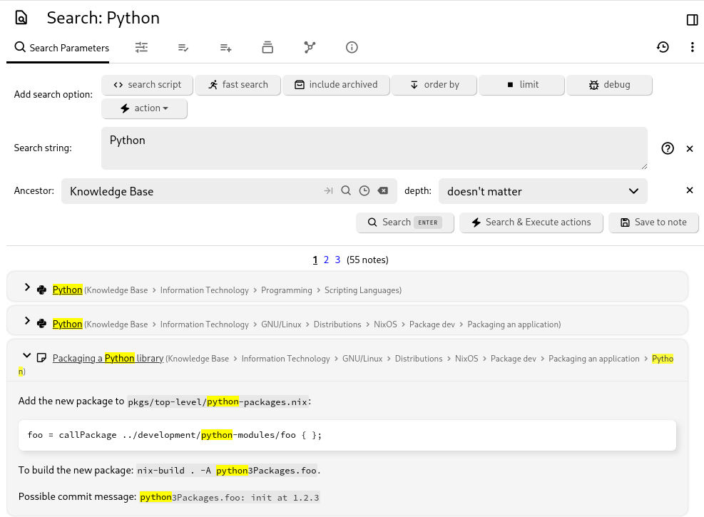

# 搜索
<figure class="image"></figure>

笔记搜索使您能够通过搜索笔记的标题、内容或[属性](../../Advanced%20Usage/Attributes.md)中的文本来查找笔记。您还可以选择保存搜索，这会创建一个特殊的搜索笔记，该笔记在导航树中可见，并将搜索结果作为子项包含其中。

## 搜索类型

有多种类型的搜索，它们都使用相同的搜索机制和查询语言：

*   <a class="reference-link" href="Quick%20search.md">快速搜索</a>，可在<a class="reference-link" href="../UI%20Elements/Launch%20Bar.md">启动栏</a>中找到，用于小型的一次性搜索。
    *   结果显示在弹出窗口中，并且具有无限滚动功能。
*   _完整搜索_ 是更高级的搜索机制。
    *   结果显示在单独的页面中，并且具有多种高级功能（搜索脚本、快速搜索、包含已归档笔记、排序方式、限制）。
    *   可以对结果应用<a class="reference-link" href="../../Advanced%20Usage/Bulk%20Actions.md">批量操作</a>，例如添加标签/关系。
    *   结果分页显示，并且可以以任何<a class="reference-link" href="../../Collections.md">集合</a>视图（例如网格、列表、日历、表格）显示。
*   某些<a class="reference-link" href="../../Collections.md">集合</a>（如看板视图）具有专用于该集合的搜索栏。
    *   在这种情况下，结果直接显示在集合中而不是弹出窗口中，并且仅限于该集合，但查询语言保持不变。

> [!NOTE]
> [跳转到笔记](Jump%20to%20%26%20command%20palette.md)是一个类似的概念，但它主要用于按标题搜索笔记，而不是按内容。不过，如果结果不令人满意，它也提供了全文搜索的方式。

## 访问搜索

*   从<a class="reference-link" href="../UI%20Elements/Launch%20Bar.md">启动栏</a>中，查找专用的 <span class="tn-icon bx bx-search"></span> 搜索按钮。
*   要将搜索限制在某个笔记及其子笔记中，请从<a class="reference-link" href="../UI%20Elements/Note%20Tree/Note%20tree%20contextual%20menu.md">笔记树上下文菜单</a>中选择 _在子树中搜索_（<span class="tn-icon bx bx-search"></span>），或按 <kbd>Ctrl</kbd>+<kbd>Shift</kbd>+<kbd>S</kbd>。
*   转到<a class="reference-link" href="Jump%20to%20%26%20command%20palette.md">跳转与命令面板</a>，查找内容，然后按结果下方的 _在完整搜索中显示_（或 <kbd>Ctrl</kbd>+<kbd>Enter</kbd>）。

## 交互

要搜索笔记，请点击<a class="reference-link" href="../UI%20Elements/Launch%20Bar.md">启动栏</a>中的 <span class="tn-icon bx bx-search"></span> 图标，或按键盘[快捷键](../Keyboard%20Shortcuts.md)。

1.  在 _搜索字符串_ 字段中设置要搜索的文本。
    1.  除了按字面搜索词语外，还可以搜索笔记的属性或特性。
    2.  有关更多信息，请参阅下面的示例。
2.  要将搜索限制在某个笔记及其子笔记中，请在 _祖先_ 中设置一个笔记。
    1.  如果搜索是从[提升的笔记](Note%20Hoisting.md)或[工作区](Workspaces.md)触发的，此值也会被预填充。
    2.  要搜索整个数据库，请将该值留空。
3.  要将搜索限制在仅几个层级（例如，在子笔记中查找但不在此笔记的子子笔记中查找），请将 _深度_ 字段设置为提供的值之一。
4.  除此之外，还可以通过 _添加搜索选项_ 菜单配置搜索，如后续章节所述。
5.  按 _搜索_（<span class="tn-icon bx bx-search"></span>）触发搜索。结果显示在搜索配置窗格下方。
6.  _搜索并执行操作_（<span class="tn-icon bx bxs-zap"></span>）条目位于 _搜索_ 旁边的菜单中，仅在至少添加了一个操作时才相关（如下文所述）。
7.  同一菜单中的 _保存到笔记_（<span class="tn-icon bx bx-save"></span>）条目将创建一个包含搜索配置的新笔记。有关更多信息，请参阅<a class="reference-link" href="../../Note%20Types/Saved%20Search.md">保存的搜索</a>。

## 功能

### 自动补全

为了帮助处理语法，Trilium 提供了自动补全功能，可通过按 <kbd>Ctrl</kbd>+<kbd>Space</kbd> 触发。

某些建议也会在您输入时自动打开：`#` 和 `~` 之后的标签和关系名称、`.` 之后的字段、运算符、值，以及 `@` 之后的笔记。诸如 `and`、`or`、`not`、`orderBy` 和 `limit` 等关键字仅在按 <kbd>Ctrl</kbd>+<kbd>Space</kbd> 时出现，因为普通单词通常是搜索词。

当列表自动打开时不会选中任何建议，因此 <kbd>Enter</kbd> 会按输入内容运行搜索。要插入建议，请用 <kbd>Down</kbd> 选择它并按 <kbd>Enter</kbd>。使用 <kbd>Ctrl</kbd>+<kbd>Space</kbd> 打开的列表以及 `@` 之后的笔记会默认选中最佳匹配项，因此 <kbd>Enter</kbd> 会插入它。

自动补全提供：

*   基本运算符，如 `*=` 和关键字（`limit`、`not`）。
*   对象类字段的字段，如 `note` 或 `~relation`，通过输入 `.` 触发。
*   上下文枚举，如 `note.type = "` 或 `note.mime = "`。
*   通过输入 `#` 提供[标签](../../Advanced%20Usage/Attributes/Labels.md)名称。
    *   名称图标上的小齿轮表示系统属性。
    *   输入标签名称后，值也会根据数据库中存在的值进行自动补全。
*   通过输入 `~` 提供[关系](../../Advanced%20Usage/Attributes/Relations.md)名称。
*   通过输入 `@` 并查找笔记，可以轻松插入[笔记 ID](../../Advanced%20Usage/Note%20ID.md)。
    *   如果笔记 ID 符合有效语法，它将显示为笔记的芯片而不是原始 ID。
    *   这对于使用笔记 ID 的查询特别有用，例如按模板搜索：`~template.noteId = @`

### 语法高亮

搜索输入具有语法高亮功能，使已识别的字段（如 `note.`）和运算符（如 `NOT`）更加突出。

同样的高亮功能也适用于<a class="reference-link" href="../../Note%20Types/Code.md">代码</a>笔记，例如用于保存查询集合：将笔记的语言设置为 _Trilium 搜索查询_。该语言默认未启用；请从<a class="reference-link" href="../UI%20Elements/Options.md">选项</a> → _代码笔记_ → _下拉菜单中可用的 MIME 类型_ 中添加它。

### 错误高亮与检查

搜索还会分两个阶段检查错误，错误将显示为红色波浪线：

*   检查器错误，用于识别常见错误模式并提供修复方法。
*   搜索错误，由服务器检查，但不指示错误发生的具体位置。

仅在运行时才会遇到的错误（例如无法用于搜索笔记内容的运算符）会显示在 _搜索错误_ 卡片中：位于搜索字符串下方，或<a class="reference-link" href="Quick%20search.md">快速搜索</a>结果的顶部。

### 多行

长或复杂的搜索可以使用换行符进行格式化，类似于 SQL 查询。换行符被视为与空格相同。

要添加新行，请按 <kbd>Shift</kbd>+<kbd>Enter</kbd>。

> [!NOTE]
> 多行仅适用于完整搜索，其他输入（如快速搜索或集合过滤器）为单行。

## 搜索选项

点击 _添加搜索选项_ 以选择要应用的选项。

*   对于每个选定的搜索选项，搜索配置将更新以显示该条目。每个搜索选项都有自己的配置。
*   要移除搜索选项，只需按它右侧的 <span class="tn-icon bx bx-x"></span> 按钮。

可用的选项有：

1.  <span class="tn-icon bx bx-code"></span> 搜索脚本
    1.  此功能允许编写一个<a class="reference-link" href="../../Note%20Types/Code.md">代码</a>笔记，由其自行处理搜索。
2.  <span class="tn-icon bx bx-run"></span> 快速搜索
    1.  搜索不会查看笔记的内容，但仍会查看笔记标题和属性、关系（基于搜索查询）。
    2.  对于大型[数据库](../../Advanced%20Usage/Database.md)，此方法可以显著加快搜索速度。
3.  <span class="tn-icon bx bx-archive"></span> 包含已归档
    1.  <a class="reference-link" href="../Notes/Archived%20Notes.md">已归档笔记</a>也将包含在结果中，否则它们将被忽略。
4.  <span class="tn-icon bx bx-arrow-from-top"></span> 排序方式
    1.  允许更改结果排序的标准，例如按创建日期或字母顺序排序，而不是按相关性（默认）。
    2.  还可以更改结果的顺序（升序或降序）。
5.  <span class="tn-icon bx bx-stop"></span> 限制
    1.  将结果限制为给定的最大值。
    2.  如果结果数量否则会很高，这可以帮助，代价是无法查看所有结果。
6.  <span class="tn-icon bx bx-bug"></span> 调试
    1.  这将在服务器日志中打印额外信息（参见<a class="reference-link" href="../../Troubleshooting/Error%20logs.md">错误日志</a>），关于搜索表达式是如何解析的。
    2.  此功能在详细了解搜索功能后特别有用，用于确定为什么复杂的搜索查询没有按预期工作。

同一菜单以 _批量操作_ 部分结束，用于应用更改，例如向匹配的笔记添加标签或关系。其分组——_标签_、_关系_、_笔记_ 和 _其他_——各自打开<a class="reference-link" href="../../Advanced%20Usage/Bulk%20Actions.md">批量操作</a>对话框中相应组的操作列表，这是在<a class="reference-link" href="../UI%20Elements/Note%20Tree.md">笔记树</a>中直接操作笔记的替代方法。选择一个会将其添加到搜索中；与其他选项不同，同一操作可以添加多次（例如应用多个标签）。定义操作后，首先按 _搜索_ 检查匹配的笔记，然后从旁边的菜单中选择 _搜索并执行操作_ 以触发操作。

## 查看搜索结果

结果显示在搜索窗格下方，默认在 _搜索预览_ 视图中。每个结果绘制为一张**片段卡片**，包含笔记标题、指向它的路径、匹配文本的简短摘录以及匹配的属性。代码笔记的摘录保留其缩进并以代码字体显示。

要以纯笔记列表形式显示结果，请从<a class="reference-link" href="../../Collections/Collection%20Properties.md">集合属性</a>栏中选择 _列表_。_列表_ 视图为每个笔记显示一行，包含笔记的标题和内容预览。

搜索还会高亮显示标题或内容中匹配的词语：

*   直接匹配使用实线绿色下划线；
*   部分匹配（由模糊搜索匹配）使用虚线橙色下划线。

此外，_搜索预览_ 视图提供：

*   **结果总数**始终显示，因此您可以立即判断查询的范围有多广。
*   **页面大小选择器**让您选择每页显示多少结果。您的选择会被记住并在您的设备之间同步（存储在 `searchResultsPageSize` 选项中），因此您不必在每台设备上重置它。
*   **点击结果的标题**会打开笔记并直接跳转到第一个匹配项。笔记内查找栏会打开并预填充搜索的第一个词，因此您可以使用查找控件逐步浏览其匹配项。要让查找栏查找整个短语，请在搜索中将该短语放在引号中，例如 `"The Lord of the Rings"`。在只读笔记中，搜索的其他词语也会被高亮显示。摘录和属性可以在不打开笔记的情况下选择。
*   _在新标签页中打开所有结果_（<span class="tn-icon bx bx-window-open"></span>，结果上方的按钮）会在各自的标签页中打开每个结果，最多 50 个。每个标签页打开时定位到其第一个匹配项，查找栏已预填充，与点击结果时相同。
*   如果匹配项位于**折叠的部分**内（例如折叠的标题），该部分会自动展开，以便匹配项可见。
*   当摘录被截断时，_显示更多_ 按钮会将卡片展开为笔记的完整内容，并高亮显示搜索词。_显示更少_ 则返回摘录。

保存的搜索还可以从<a class="reference-link" href="../UI%20Elements/Note%20menu.md">笔记菜单</a>的 _打印/导出为 PDF…_ 条目中<a class="reference-link" href="../Notes/Printing%20%26%20Exporting%20as%20PDF.md">打印或导出为 PDF</a>，可选择 _搜索预览_ 或 _列表_ 视图。结果以列表形式布局，与打印开始时的状态一致。

## 简单笔记搜索示例

*   `rings tolkien`：全文搜索，查找同时包含 "rings" 和 "tolkien" 的笔记。
*   `"The Lord of the Rings" Tolkien`：全文搜索，其中 "The Lord of the Rings" 必须精确匹配。
*   `note.content *=* rings OR note.content *=* tolkien`：查找内容中包含 "rings" 或 "tolkien" 的笔记。
*   `towers #book`：结合全文搜索和属性搜索，查找包含 "towers" 且具有 "book" 标签的笔记。写 `towers AND #book` 效果相同；要搜索 "and" 这个词本身，请将其放在引号中。
*   `c#` 或 `towers#book`：单词内的 `#` 或 `~` 是文本的一部分，因此这些会查找包含 "c#" 或 "towers#book" 的笔记。要开始一个标签或关系，请在其前面加一个空格。
*   `towers #book or #author`：搜索包含 "towers" 且具有 "book" 或 "author" 标签的笔记。
*   `towers #!book`：搜索包含 "towers" 且不具有 "book" 标签的笔记。
*   `#book #publicationYear = 1954`：查找具有 "book" 标签且 "publicationYear" 设置为 1954 的笔记。
*   `#genre *=* fan`：查找具有 "genre" 标签且包含子字符串 "fan" 的笔记。其他运算符包括 `*=*` 表示 "包含"，`=*` 表示 "开头为"，`*=` 表示 "结尾为"，`!=` 表示 "不等于"。
*   `#book #publicationYear >= 1950 #publicationYear < 1960`：使用数值运算符查找 1950 年代出版的所有书籍。
*   `#dateNote >= TODAY-30`：查找具有 "dateNote" 标签且在过去 30 天内的笔记。支持的日期值包括 NOW +- 秒、TODAY +- 天、MONTH +- 月、YEAR +- 年。
*   `~author.title *=* Tolkien`：查找与标题包含 "Tolkien" 的作者相关的笔记。
*   `#publicationYear %= '19[0-9]{2}'`：使用 '%=' 运算符匹配正则表达式（regex）。此功能自 Trilium 0.52 起可用。
*   `note.content %= '\\d{2}:\\d{2} (PM|AM)'`：查找提及时间的笔记。正则表达式中的反斜杠必须转义。

## 高级用例

*   `~author.relations.son.title = 'Christopher Tolkien'`：搜索具有 "author" 关系指向一个具有 "son" 关系指向 "Christopher Tolkien" 的笔记的笔记。这可以通过以下笔记结构建模：
    *   Books
        *   Lord of the Rings
            *   标签："book"
            *   关系："author" 指向 "J. R. R. Tolkien" 笔记
    *   People
        *   J. R. R. Tolkien
            *   关系："son" 指向 "Christopher Tolkien" 笔记
            *   Christopher Tolkien
*   `~author.title *= Tolkien OR (#publicationDate >= 1954 AND #publicationDate <= 1960)`：使用布尔表达式和括号对表达式进行分组。
*   `towers (#genre = fantasy OR #genre = scifi)`：分组可以直接打开表达式部分，括号前不需要 `#` 或 `~`。这里它查找包含 "towers" 且类型为 fantasy 或 scifi 的笔记。
*   `note.parents.title = 'Books'`：查找父笔记名为 "Books" 的笔记。
*   `note.parents.parents.title = 'Books'`：查找祖父笔记名为 "Books" 的笔记。
*   `note.ancestors.title = 'Books'`：查找祖先笔记名为 "Books" 的笔记。
*   `note.children.title = 'sub-note'`：查找子笔记名为 "sub-note" 的笔记。
*   `note.links.title = 'Tolkien'`：查找链接到名为 "Tolkien" 的笔记的笔记。
*   `note.backlinks.title = 'Reading list'`：查找 "Reading list" 链接到的笔记。
*   链接是您创建的关系（如 `~author`），或由内容创建的关系：内部链接（`~internalLink`）、图片（`~imageLink`）、包含的笔记（`~includeNoteLink`）或关系图连接（`~relationMapLink`）。配置笔记的关系（如 `~template` 或保存的搜索的 `~ancestor`）不是链接。

另请参阅<a class="reference-link" href="Search/Under%20the%20hood.md">底层原理</a>以获取更多语法参考。

### 使用笔记属性搜索

笔记具有可在搜索中使用的属性，例如 `noteId`、`dateModified`、`dateCreated`、`isProtected`、`type`、`title`、`text`、`content`、`rawContent`、`ownedLabelCount`、`labelCount`、`ownedRelationCount`、`relationCount`、`ownedRelationCountIncludingLinks`、`relationCountIncludingLinks`、`ownedAttributeCount`、`attributeCount`、`targetRelationCount`、`targetRelationCountIncludingLinks`、`parentCount`、`childrenCount`、`isArchived`、`contentSize`、`noteSize` 和 `revisionCount`。

这些属性可以通过 `note.` 前缀访问，例如 `note.type = code AND note.mime = 'application/json'`。

### 排序方式与限制

```
#author=Tolkien orderBy #publicationDate desc, note.title limit 10
```

此示例将：

1.  查找具有作者标签 "Tolkien" 的笔记。
2.  按 `publicationDate` 降序排列结果。
3.  如果出版日期相同，则使用 `note.title` 作为次要排序。
4.  将结果限制为前 10 个笔记。

### 否定

某些查询只能用否定来表达：

```
#book AND not(note.ancestors.title = 'Tolkien')
```

此查询查找所有不在 "Tolkien" 子树中的书籍笔记。

## 底层原理

请参阅[专用页面](Search/Under%20the%20hood.md)以了解 Trilium 中渐进式搜索的工作原理，以及一些高级用例。

## 从 URL 自动触发搜索

您可以打开 Trilium 并通过在 URL 中包含[URL 编码](https://meyerweb.com/eric/tools/dencoder/)的搜索字符串来自动触发搜索：

`http://localhost:8080/#?searchString=abc`

## 搜索配置

### 参数

| 参数 | 值 | 描述 |
| --- | --- | --- |
| `MIN_FUZZY_TOKEN_LENGTH` | 3 | `~=` 和 `~*` 运算符接受的最小字符数 |
| `MAX_EDIT_DISTANCE` | 2 | 字符更改的上限，仅由 7 个以上字符的词语达到；较短的词语允许更少。参见上文的 _模糊容差_ 部分 |
| `RESULT_SUFFICIENCY_THRESHOLD` | 5 | 模糊回退前的最小精确结果数 |
| `MAX_CONTENT_SIZE` | 10MB | 搜索处理的笔记内容最大大小 |

### 限制

*   搜索的笔记内容限制为每个笔记 10MB，以防止性能问题
*   超过此限制的笔记仍将包含在标题和属性搜索中
*   3 个字符或更少的词语精确匹配；拼写错误容差从 4 个字符开始