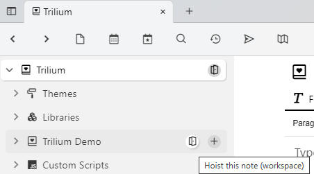

# 工作区

工作区是建立在[笔记提升](Note%20Hoisting.md)之上的一个概念。它基于这样一个理念：用户有几个不同的兴趣领域。一个例子可能是“个人”和“工作”，这两个领域相当不同，彼此之间没有交互。当我专注于工作时，我并不真正关心个人笔记。

到目前为止，工作区包含以下功能：

*   [笔记提升](Note%20Hoisting.md) - 你可以“缩放”到工作区子树中，只关注相关的笔记
*   轻松进入工作区：
    
    
*   在新标签页中打开工作区：右键点击<a class="reference-link" href="../UI%20Elements/Tabs.md">标签页</a>栏的  按钮，然后选择工作区。
*   在标签页中视觉识别工作区：
    

### 配置

| 标签 | 描述 |
| --- | --- |
| `workspace` | 将此笔记标记为工作区，进入工作区的按钮由此控制 |
| `workspaceIconClass` | 定义 box 图标的 CSS 类，当提升到此笔记时将在标签页中使用，以及标签页栏  按钮的菜单中使用 |
| `workspaceTabBackgroundColor` | 当提升到此笔记时在笔记标签页中使用的 CSS 颜色，以及标签页栏  按钮菜单中工作区图标使用的颜色，可使用任何 CSS 颜色格式，例如 "lightblue" 或 "#ddd"。参见 [https://www.w3schools.com/cssref/css\_colors.asp](https://www.w3schools.com/cssref/css_colors.asp)。 |
| `workspaceCalendarRoot` | 用此标签标记笔记将为<a class="reference-link" href="../../Advanced%20Usage/Advanced%20Showcases/Day%20Notes.md">日记笔记</a>定义一个新的按工作区划分的日历。如果没有这样的笔记，将使用全局日历。 |
| `workspaceTemplate` | 创建新笔记时，此笔记将出现在可用模板的选择中，但仅在提升到包含此模板的工作区时才会出现 |
| `workspaceSearchHome` | 当提升到此工作区笔记的某个祖先时，新的搜索笔记将作为此笔记的子笔记创建 |
| `workspaceInbox` | 当提升到此工作区笔记的某个祖先时，新笔记的默认收件箱位置。更多信息参见<a class="reference-link" href="../Notes/Note%20Inbox.md">笔记收件箱</a>。 |