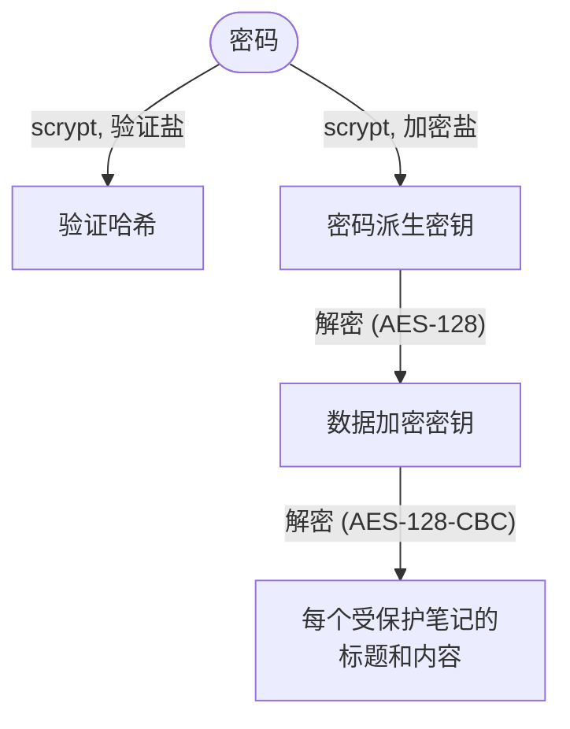

# 受保护的笔记
Trilium 旨在存储各种各样的数据，包括敏感信息，如个人日记、凭据或机密文档。为了保护这类内容，Trilium 提供了保护笔记的选项，这涉及以下措施：

*   **加密：** 受保护的笔记使用由你的密码派生出的密钥进行加密。这确保在没有正确密码的情况下，受保护的笔记保持不可解读。即使有人获得了你的 Trilium [数据库](../../Advanced%20Usage/Database.md)的访问权限，他们也无法读取你加密的笔记。
*   **限时访问：** 要访问受保护的笔记，你必须先输入密码，这会解密笔记以便阅读和写入。然而，在指定的不活动时间之后（默认为 10 分钟），笔记会从内存中卸载，需要你重新输入密码才能再次访问。
    *   当你与受保护的笔记交互时，会话超时会自动延长，因此如果你正在积极编辑，会话会保持打开。然而，如果你切换到未受保护的笔记，会话计时器就会启动，除非你返回受保护的笔记，否则会话将在 10 分钟不活动后过期。
*   **保护范围：** 受保护的笔记确保其内容的机密性，并部分确保其完整性。虽然未经授权的用户无法读取或编辑受保护的笔记，但他们仍然可以在受保护会话之外删除或移动它们。

## 使用受保护的笔记

默认情况下，笔记是未受保护的。要保护一个笔记，只需点击笔记标题旁边的盾牌图标，如下所示：

要一次性保护或取消保护整个子树，请在笔记树中右键点击其顶层笔记，然后选择 _保护子树_ 或 _取消保护子树_。如果没有正在运行的受保护会话，对话框会解释该操作的作用并要求你输入密码，因此你不必事先启动受保护会话。

### 移除保护

取消保护会解密笔记：从那时起，它们的内容、附件和修订版本将以未加密的方式存储，在备份和同步服务器上也是如此。因此，_取消保护子树_ 总是会先要求确认，即使在受保护会话正在运行时也是如此。

## 哪些内容会被加密？

Trilium 加密受保护笔记中的数据，但不加密其元数据。具体来说：

**已加密：**

*   笔记标题
*   笔记内容
*   图片
*   文件附件

**未加密：**

*   笔记结构（即，受保护笔记的存在仍然可见）
*   元数据，例如最后修改日期
*   [属性](../../Advanced%20Usage/Attributes.md)

## 加密细节

以下步骤概述了 Trilium 中加密和解密的工作方式：

1.  用户输入密码。
2.  密码与"密码验证"[盐](https://en.wikipedia.org/wiki/Salt_\(cryptography\))一起通过 [scrypt](https://en.wikipedia.org/wiki/Scrypt) 算法处理，以确认密码正确。
3.  然后密码再次通过 scrypt 使用"加密"盐进行处理，生成一个哈希值。
    *   Scrypt 用于[密钥拉伸](https://en.wikipedia.org/wiki/Key_stretching)，使密码更难被猜出。
4.  生成的哈希值用于解密实际的_数据加密密钥_。
    *   数据加密密钥使用 [AES-128](https://en.wikipedia.org/wiki/Advanced_Encryption_Standard) 和随机 [IV](https://en.wikipedia.org/wiki/Initialization_vector) 进行加密。
    *   数据加密密钥在[数据库](../../Advanced%20Usage/Database.md)初始化期间随机生成，并在文档的整个生命周期中保持不变。当密码更改时，只有此密钥会被重新加密。
5.  然后使用数据加密密钥解密笔记的实际内容，包括其标题和正文。
    *   使用的加密算法是 AES-128 配合 [CBC 模式](https://en.wikipedia.org/wiki/Block_cipher_mode_of_operation)，其中每次加密操作都会生成一个唯一的 IV，并与密文一起存储。

## 共享受保护的笔记

受保护的笔记无法像普通笔记那样共享。其加密确保只有拥有正确密码的授权用户才能访问它们。