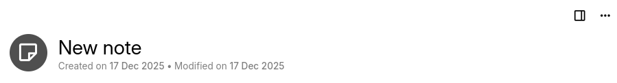
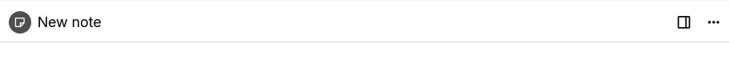

# 标题
除了内容之外，**标题**是[笔记](../Notes.md)的两个主要属性之一。它是显示在每条笔记顶部可编辑字段中的简短、人类可读的名称，也是在整个界面中标识该笔记的依据（在<a class="reference-link" href="../UI%20Elements/Note%20Tree.md">笔记树</a>、标签页、<a class="reference-link" href="../UI%20Elements/Breadcrumb.md">面包屑</a>以及<a class="reference-link" href="../../Note%20Types/Text/Links/Internal%20(reference)%20links.md">内部（引用）链接</a>中）。

在内部，笔记通过唯一的<a class="reference-link" href="../../Advanced%20Usage/Note%20ID.md">笔记 ID</a>而非标题来标识，因此标题纯粹是为了方便你使用。这带来了一些影响：

*   **标题不必唯一。** 你可以拥有任意数量的同名笔记而不会产生冲突。
*   **重命名笔记永远不会破坏指向它的链接。** 笔记之间的链接指向底层笔记，因此更改标题不会影响现有链接（它们只会显示新标题）。
*   **标题可以留空。** 没有标题的笔记会显示一个占位符（_在此输入笔记标题…_），但在其他方面完全有效。

此外：

*   标题长度没有限制，但在导出时标题可能会被截断。
*   没有禁止使用的符号，不支持的字符在导出时会被去除。
*   导出为 ZIP 文件时，元文件会包含完整标题，Trilium 在重新导入时会识别该标题。

## 内联标题

<a class="reference-link" href="../../Note%20Types/Text.md">文本</a>笔记有一种特殊的标题栏行为：[笔记标题](Title.md)最初以较大的字体显示，同时还显示创建日期和修改日期等附加信息。

当标题被滚动过去后，将改为显示固定标题。

占据整个屏幕的笔记类型，例如<a class="reference-link" href="../../Note%20Types/Code.md">代码</a>和<a class="reference-link" href="../../Note%20Types/Canvas.md">画布</a>，将始终只有固定标题栏。

在笔记标题下方，如果笔记为空，会显示<a class="reference-link" href="New%20note%20type%20switcher.md">新建笔记类型切换器</a>。

<figure class="image"><figcaption><em>内联标题</em>，显示在笔记顶部，可以被滚动过去。</figcaption></figure><figure class="image"><figcaption>固定标题栏。标题仅在滚动过<em>内联标题</em>后才会出现。</figcaption></figure>

### 编辑标题

要重命名笔记，只需点击标题字段并输入即可。更改会在你输入时自动保存。

你也可以直接从<a class="reference-link" href="../UI%20Elements/Note%20Tree.md">笔记树</a>开始编辑标题：选择一条笔记并按 <kbd>Enter</kbd>（参见<a class="reference-link" href="../Keyboard%20Shortcuts.md">键盘快捷键</a>中的_编辑笔记标题_），这会将焦点定位到当前活动笔记的标题字段。

> [!NOTE]
> 标题可以包含任何字符，包括 Unicode 和 emoji。出于安全考虑，标题中的任何 HTML 都会被自动去除，因此标题始终被视为纯文本。

### 在标题和内容之间轻松导航

当光标位于标题字段时，按 <kbd>Enter</kbd> 会将焦点移入笔记内容。对于<a class="reference-link" href="../../Note%20Types/Text.md">文本</a>笔记，这还会在文档最顶部插入一个新的空段落，因此你可以立即开始写作——就像其他笔记应用一样。

这使得创建笔记、输入标题、按 <kbd>Enter</kbd> 并直接继续输入正文成为可能，无需去碰鼠标。

### 处理新笔记

当你创建一条新笔记时，它会获得一个默认标题（_新笔记_），该标题已被预先选中，因此你可以直接输入名称来替换它。新笔记的默认标题可以按分区自定义——参见<a class="reference-link" href="../../Advanced%20Usage/Default%20Note%20Title.md">默认笔记标题</a>。

如果你最终决定不想要这条笔记，在刚创建的笔记标题仍处于聚焦状态时按 <kbd>Escape</kbd> 将会丢弃它。

### 自动生成的标题

有些笔记的标题是自动分配的，而非手动输入的：

*   <a class="reference-link" href="../../Advanced%20Usage/Advanced%20Showcases/Day%20Notes.md">日记笔记</a>中的**日、周、月和年笔记**根据可配置的日期模式命名。
*   <a class="reference-link" href="../../Note%20Types/Saved%20Search.md">保存的搜索</a>笔记根据其执行的搜索来命名。
*   当笔记被复制时，副本的标题会附加一个后缀，以区别于原始笔记。

### 受保护的笔记

对于<a class="reference-link" href="Protected%20Notes.md">受保护的笔记</a>，标题_不会_被加密——只有内容会被加密。因此，即使没有活动的受保护会话，标题在树和标签页中仍然可见。然而，在锁定状态下，标题字段是只读的，在你输入密码之前无法编辑。

<a class="reference-link" href="Protected%20Notes.md">受保护的笔记</a>的标题会与其内容一起被加密。在输入密码之前，Trilium 无法解密标题，因此它会显示为 `[protected]`，并且标题无法修改。

一旦你输入密码并激活了受保护会话，真实的标题就会被解密并显示出来，并再次变为可编辑。