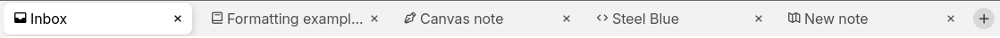

# 标签页
<figure class="image image-style-align-center"></figure>

在 Trilium 中，标签页可以方便地在笔记之间切换。

## 布局

取决于<a class="reference-link" href="Vertical%20and%20horizontal%20layout.md">垂直和水平布局</a>：

*   对于垂直布局，标签页将放置在顶部，但位于<a class="reference-link" href="Note%20Tree.md">笔记树</a>的右侧。
*   对于水平布局，标签页将放置在顶部全宽位置，位于[笔记树](Note%20Tree.md)上方，从而可以更舒适地显示更多标签页。

## 交互

*   要创建新标签页，请按最后一个标签页右侧的  按钮。
*   右键单击或按住  按钮会显示一个菜单，其中包含：
    *   _新建标签页_。
    *   如果存在任何<a class="reference-link" href="../Navigation/Workspaces.md">工作区</a>，则每个工作区对应一个条目，点击后会在新标签页中打开该工作区，并将其提升到该工作区中。
    *   _最近更改的笔记_：最多 15 条笔记，最近更改的排在前面，每条笔记的路径显示在右侧。已在标签页中打开的笔记不会列出，在[提升的笔记](../Navigation/Note%20Hoisting.md)中只列出其后代。选择一条笔记会在新标签页中打开它。
    *   _所有最近更改_，会打开<a class="reference-link" href="Recent%20Changes.md">最近更改</a>对话框。
*   要关闭标签页，请按相应的  按钮。
*   为了多任务处理，标签页可以与<a class="reference-link" href="Split%20View.md">分屏视图</a>一起使用。每个标签页可以有一个或多个笔记，水平显示。
*   可以通过拖放将标签页重新排序到新位置。
*   可以通过向上或向下拖动标签页，将现有标签页显示在新窗口中。无法将标签页重新合并到另一个窗口中。

## 键盘交互

由于标签页是常用功能，因此有多个键盘快捷键可用：

*   <kbd>Ctrl</kbd>+<kbd>T</kbd> 打开新标签页。
*   <kbd>Ctrl</kbd>+<kbd>W</kbd> 关闭当前标签页。
*   <kbd>Ctrl</kbd>+<kbd>Shift</kbd>+<kbd>T</kbd> 重新打开上次关闭的标签页。
*   <kbd>Ctrl</kbd>+<kbd>Tab</kbd> 和 <kbd>Ctrl</kbd>+<kbd>Shift</kbd>+<kbd>Tab</kbd> 切换到下一个或上一个标签页。
*   <kbd>Ctrl</kbd>+<kbd>1</kbd>、<kbd>Ctrl</kbd>+<kbd>2</kbd>，直到 <kbd>Ctrl</kbd>+<kbd>9</kbd> 可激活第一个、第二个直到第九个标签页。
*   还有一个跳转到最后一个标签页的快捷键，但默认未分配按键。

## 全屏

要以全屏显示 Trilium，请按 <kbd>F11</kbd> 或<a class="reference-link" href="Global%20menu.md">全局菜单</a>中的  _全屏_ 按钮。在全屏状态下，标签栏会在<a class="reference-link" href="Right%20Sidebar.md">右侧边栏</a>切换按钮之前显示一个  _退出全屏_ 按钮；按下它可返回普通窗口。

## 后台标签页

当 Trilium 启动时，它会重新打开上次会话中的标签页。只有活动标签页会立即加载其笔记；其他每个标签页都会在您第一次切换到它时加载其笔记。当打开许多标签页时，这可以保持启动速度，尤其是显示集合的标签页。

这同样适用于在后台打开的标签页，例如通过中键单击或 <kbd>Ctrl</kbd>+单击链接打开的标签页。

## 移动端

<figure class="image image-style-align-right image_resized" style="width:34.12%;"></figure>

<a class="reference-link" href="../../Installation%20%26%20Setup/Mobile%20Frontend.md">移动端前端</a>也支持标签页。

自 v0.102.0 起，通过按<a class="reference-link" href="Launch%20Bar.md">启动栏</a>中的专用标签页切换按钮来显示标签页。在此视图中，标签页以网格形式布局，并带有笔记内容的预览。

弹出窗口右上角的上下文菜单按钮允许创建新标签页、重新打开上次关闭的标签页以及关闭所有标签页。

<a class="reference-link" href="Split%20View.md">分屏视图</a>也会在标签页切换器中指示，标签页中会显示两个标题。

> [!NOTE]
> v0.102.0 之前的版本也支持标签页，但它们直接显示在<a class="reference-link" href="Launch%20Bar.md">启动栏</a>上方。之所以决定使用更像移动端的标签页切换器，是因为原来的标签栏无法同时支持许多标签页，而且新设计更符合移动应用程序处理标签页的方式。