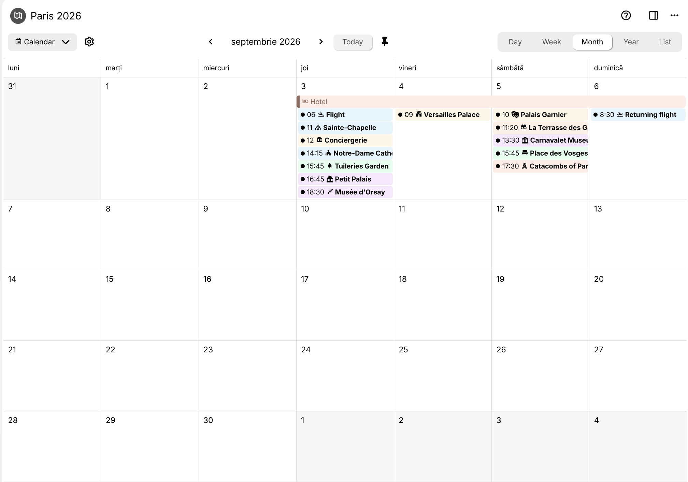
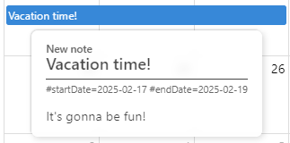
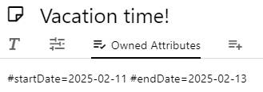
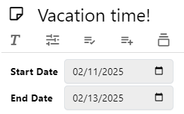
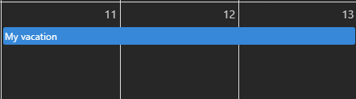
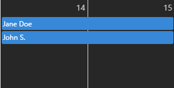

# 日历
<figure class="image"></figure>

日历视图会将每个具有开始日期（以及可选的结束日期）的子笔记作为事件显示在日历中。

日历视图有多种显示模式：

*   月视图，显示整个月，可以插入全天事件。特定时间的事件和全天事件都会列出。
*   周视图，将一周的 7 天（如果隐藏周末则为 5 天）按列显示。此模式允许输入和显示特定时间的事件，而不仅仅是全天事件。
*   日视图，仅查看单日。特别适用于繁忙的日程或移动端视图。
*   列表视图，按顺序显示给定月份的所有事件。
*   年视图，显示整年以便快速参考。

与其他集合视图类型不同，日历视图还允许某种形式的交互，例如移动事件以及创建新事件。

## 创建日历

在<a class="reference-link" href="../Basic%20Concepts%20and%20Features/UI%20Elements/Note%20Tree.md">笔记树</a>中右键单击现有笔记，然后选择*插入子笔记* → *集合* → *日历*。

## 创建新事件/笔记

要创建新事件：

*   首先，单击所需的日期（月视图和年视图）或所需的时间段（日视图）。
*   或者，跨多天（或时间段）拖动以同时设置开始日期和结束日期。

无论哪种情况，都会弹出一个小窗口，提示输入标题以及将要创建的事件的日期和时间。日期和时间可以在此处更改，方式与现有事件的弹出视图相同（见下文）。

此时，事件尚未创建，以防止误点击。可以选择添加标题，然后按*创建*按钮。如果未提供标题，事件将遵循<a class="reference-link" href="../Advanced%20Usage/Default%20Note%20Title.md">默认笔记标题</a>规则。

日期和时间下方的 <span class="tn-icon bx bx-detail"></span> 模板字段显示事件笔记所使用的笔记类型或模板。要从另一个模板创建事件，请按该字段并从列表中选择；日历会记住下次事件的选择。选择*更多模板…*可更改列出的模板（参见[事件模板](#event-templates)）。为事件输入的日期和时间会替换模板携带的任何日期和时间。

要在创建事件之前为其设置时间（例如，在月视图中单击某一天后），请按*添加时间*并设置开始和结束时间；持续时间显示在其右侧。要再次将事件设为全天，请按该行末尾的 <span class="tn-icon bx bx-x"></span> 按钮。添加或移除时间会保留日期，因此事件可以在某一天的某个时间开始，并在另一天的某个时间结束（例如夜班）。更改开始日期或时间会以相同的量移动结束时间，保持持续时间不变。空的结束日期意味着事件在开始当天结束；将结束时间设置在开始时间之前会将结束日期移到第二天。

创建事件后，它将显示在日历上。要编辑事件的内容（包括重复），请单击它以打开弹出视图。

> [!NOTE]
> 从日历创建新笔记将遵循 Collection 笔记上设置的 `~child:template` 关系（如果已设置）。

## 与事件交互

*   将鼠标悬停在事件上会显示有关该笔记的信息。  
    
*   左键单击事件将打开一个专用弹出窗口，用于快速配置事件或编辑其笔记内容。
*   右键单击将提供更多选项，包括在新的分屏或窗口中打开笔记。
*   在日历上拖放事件可将其移动到另一天。
*   可以通过将鼠标放在事件的右边缘并拖动鼠标来更改事件的长度。

在[只读](../Basic%20Concepts%20and%20Features/Notes/Read-Only%20Notes.md)日历上，事件无法拖动、调整大小或创建，其上下文菜单仅提供打开它们的位置，并且固定当前日期的按钮是隐藏的。在月视图、周视图和日视图之间切换仍然有效，但选择不会被保存。

### 弹出视图

单击事件时，事件附近会显示一个弹出窗口，其中包含以下信息：

*   事件的标题和图标，两者均可编辑。
*   用于与事件交互的按钮：
    *   在同一窗格、新标签页等中打开事件。
    *   用于更改事件颜色的颜色选择器。
    *   用于从日历中移除事件的按钮，可以选择删除其对应的笔记。
*   日历特定功能：
    *   开始日期，对于跨多天的事件，还有结束日期。
    *   开始和结束时间及其右侧的持续时间，以及一个 <span class="tn-icon bx bx-x"></span> 按钮，用于移除时间，使事件成为全天事件。全天事件则显示*添加时间*按钮。
    *   一个完整的重复编辑器，从时间下方的下拉菜单打开，可使同一事件每周、每月等显示。
*   标记的<a class="reference-link" href="../Advanced%20Usage/Attributes/Promoted%20Attributes.md">提升属性</a>（如果有）。
*   笔记的内容，可以直接从面板编辑。

要关闭弹出窗口：

*   按弹出窗口右上角的 X 按钮。
*   在日历中，按弹出窗口外的任意位置。
*   或者直接按 <kbd>Escape</kbd> 键。

即使弹出视图已打开，也可以通过单击事件在事件之间切换。

事件之间可以具有<a class="reference-link" href="../Note%20Types/Text/Links/Internal%20(reference)%20links.md">内部（引用）链接</a>，单击此类链接将自动将日历导航到正确的日期，并将弹出视图导航到新笔记。

## 移动端交互

当 Trilium 在移动端时，与日历的交互略有不同：

*   单击事件会显示弹出视图，允许编辑事件。
*   长按事件会触发上下文菜单，包括在<a class="reference-link" href="../Basic%20Concepts%20and%20Features/Navigation/Quick%20edit.md">快速编辑</a>中打开的选项。
*   要插入新事件，请触摸并按住空白区域。成功后，空白区域将变为彩色以指示选择。
    *   在释放之前，跨多个区域拖动以创建多天事件。
    *   释放时，将出现提示以输入笔记标题。
*   要移动现有事件，请触摸并按住事件，直到其附近的空白区域变为彩色。
    *   此时可以在日历上跨其他日期拖动事件。
    *   或者可以通过点击事件右端的小圆圈来调整事件大小。
    *   要退出编辑模式，只需点击日历上任意位置的空白区域。

## 配置日历视图

在<a class="reference-link" href="Collection%20Properties.md">集合属性</a>中，可以：

*   在周视图中隐藏周末。
*   在日历上显示周数。
*   在月视图、年视图和列表视图中隐藏常规事件（参见[隐藏常规事件](#hiding-routine-events)）。
*   设置时间段持续时间（日视图/周视图中每个时间行的长度）。
*   设置时间段标签间隔（日视图/周视图中时间标签在轴上出现的频率）。

相同的设置也列在 <span class="tn-icon bx bx-cog"></span> *日历属性*对话框的*常规*下（有关如何打开它，请参见[事件模板](#event-templates)）。无论日历处于哪种视图，都会在那里列出时间段。其*包含的笔记*部分设置是否显示已归档的笔记以及日历查找事件的深度（参见[限制深度](#limiting-the-depth)）。

### 事件模板

默认情况下，新事件是<a class="reference-link" href="../Note%20Types/Text.md">文本</a>笔记。要从其他笔记类型创建事件，或从具有预定义内容和属性（例如颜色）的<a class="reference-link" href="../Advanced%20Usage/Templates.md">模板</a>创建事件，请从<a class="reference-link" href="../Basic%20Concepts%20and%20Features/UI%20Elements/Note%20menu.md">笔记菜单</a>或<a class="reference-link" href="Collection%20Properties.md">集合属性</a>的设置菜单中打开 <span class="tn-icon bx bx-cog"></span> *日历属性*对话框，然后找到*事件模板*。在这里您可以：

*   通过按 <span class="tn-icon bx bx-list-plus"></span> *添加现有模板*按钮，然后选择所需的笔记类型或模板，来包含已在知识库中创建的笔记类型或笔记模板。
*   通过按 <span class="tn-icon bx bx-plus"></span> *创建新模板*按钮来创建新模板。该模板作为日历的子笔记创建，不会作为事件显示。
*   按 <span class="tn-icon bx bx-x"></span> 按钮从列表中移除模板。模板仅从列表中移除，不会被删除。
*   按自定义模板的 <span class="tn-icon bx bx-dots-vertical-rounded"></span> 按钮以编辑、在新窗口中打开、复制或删除它。
*   通过拖动手柄来拖动模板，以重新排列创建事件时显示的列表顺序。

该对话框在只读日历上不可用，在标记有 `#calendarRoot` 或 `#workspaceCalendarRoot` 的日历上也不可用（参见[与日记/日历一起使用](#using-with-the-journal--calendar)）。

### 事件属性

事件可以在月视图中、以及在周视图和日视图中（对于全天事件和足够高以容纳它们的时间事件）在其标题下方显示其属性的值。要选择显示哪些属性，请打开 <span class="tn-icon bx bx-cog"></span> *日历属性*对话框（有关如何打开它，请参见[事件模板](#event-templates)），然后找到*事件属性*。它列出了日历定义的<a class="reference-link" href="../Advanced%20Usage/Attributes/Promoted%20Attributes.md">提升属性</a>，以及其事件自身定义的属性。在这里您可以：

*   打开某个属性以在事件上显示它。新属性在您打开之前是隐藏的，这可以防止日历变得杂乱。
*   通过拖动手柄来拖动属性，以更改事件显示它们的顺序。
*   创建新属性（会立即显示在事件上），或编辑或删除日历定义的属性。

事件的日期、时间和重复不会列出，因为日历始终自行显示它们。

要在不打开事件的情况下更改属性的值，请右键单击事件（或在手机上长按它），并使用其上下文菜单的*属性*部分。它列出了“复选框”、“选择”和“日期”类型的已显示属性，其工作方式与[看板](Kanban%20Board.md)上相同。

如果事件具有 `#calendar:displayedAttributes` 标签（包括从日历继承的标签），则显示该标签中列出的属性。

## 使用属性配置日历

可以将以下属性添加到 Collection 类型：

<table>
    <thead>
        <tr>
            <th>名称</th>
            <th>描述</th>
        </tr>
    </thead>
    <tbody>
        <tr>
            <td><code>#calendar:hideWeekends</code></td>
            <td>存在时（无论值如何），将从日历中隐藏周六和周日。</td>
        </tr>
        <tr>
            <td><code>#calendar:weekNumbers</code></td>
            <td>存在时（无论值如何），将在日历上显示周数。</td>
        </tr>
        <tr>
            <td><code>#calendar:hideRoutineEvents</code></td>
            <td>存在时（无论值如何），将在月视图、年视图和列表视图中隐藏常规事件。参见<a href="#hiding-routine-events">隐藏常规事件</a>。</td>
        </tr>
        <tr>
            <td><code>#calendar:initialDate</code></td>
            <td>更改日历打开时的日期。不存在时，日历在当前日期打开。</td>
        </tr>
        <tr>
            <td><code>#calendar:view</code></td>
            <td><p>在日历中显示哪种视图：</p><ul><li><code>timeGridDay</code> 用于<em>日</em>视图；</li><li><code>timeGridWeek</code> 用于<em>周</em>视图；</li><li><code>dayGridMonth</code> 用于<em>月</em>视图；</li><li><code>multiMonthYear</code> 用于<em>年</em>视图；</li><li><code>listMonth</code> 用于<em>列表</em>视图。</li></ul><p>任何其他值都将被忽略，而使用默认视图（月）。</p><p>使用 UI 按钮更改视图时，此标签的值会自动更新。</p></td>
        </tr>
        <tr>
            <td><code>#calendar:slotDuration</code></td>
            <td>设置日历上每个时间段的长度。默认为 <code>00:15:00</code>（15 分钟）。必须采用“HH:MM:SS”格式。例如，要每 10 分钟创建一个时间段，您应设置 <code>#calendar:slotDuration="00:10:00"</code>。</td>
        </tr>
        <tr>
            <td><code>#calendar:slotLabelInterval</code></td>
            <td>设置日历上时间段的标签频率。默认为 <code>01:00:00</code>（1 小时）。必须采用“HH:MM:SS”格式。例如，要每 30 分钟标记一次时间段，您应设置 <code>#calendar:slotLabelInterval="00:30:00"</code>。</td>
        </tr>
        <tr>
            <td><code>~child:template</code></td>
            <td>定义日历中新创建笔记的模板（通过拖动或单击）。</td>
        </tr>
    </tbody>
</table>

此外，一周的第一天可以是周日或周一，可以从应用程序设置中调整。

## 使用属性配置日历事件

对于日历的每个笔记，可以使用以下属性：

| 名称 | 描述 |
| --- | --- |
| `#startDate` | 事件开始的日期，将在日历中显示它。格式为 `YYYY-MM-DD`（年、月、日以减号分隔）。 |
| `#endDate` | 与 `startDate` 类似，如果事件跨越多天，则指明结束日期。日期是包含的，因此结束日也会被考虑。对于单日事件，该属性可以缺失。 |
| `#startTime` | 事件开始的时间。如果此值缺失，则事件被视为全天事件。格式为 `HH:MM`（24 小时制的小时和分钟）。 |
| `#endTime` | 与 `startTime` 类似，指明事件结束的时间（与 `endDate`（如果存在）或 `startDate` 相关）。 |
| `#recurrence` | 这是一个可选的 CalDAV `RRULE` 字符串，如果存在，则确定任务是否应重复。请注意，它不包括 `DTSTART` 属性，该属性直接派生自 `#startDate` 和 `#startTime`。有关有效 `RRULE` 字符串的示例，请参见 [https://icalendar.org/rrule-tool.html](https://icalendar.org/rrule-tool.html) |
| `#color` | 以指定颜色显示事件（命名如 `red`、`gray` 或十六进制如 `#FF0000`）。这也会更改笔记在其他位置（如笔记树）的颜色。 |
| `#calendar:color` | **❌️ 自 v0.100.0 起已移除。请改用** `#color` **。**      <br>  <br>与 `#color` 类似，但仅将颜色应用于日历中的事件，而不应用于其他位置（如笔记树）。 |
| `#iconClass` | 如果存在，笔记的图标将显示在事件标题的左侧。 |
| `#calendar:title` | 将事件的标题更改为指向笔记的标题以外的属性，可以是标签或关系（不带 `#` 或 `~` 符号）。有关更多信息，请参见*用例*。 |
| `#calendar:titleTemplate` | 更改事件在日历上显示时使用的标题，对于重复事件的每次出现都会重新填充。有关在生日上显示年龄的信息，请参见*用例*。 |
| `#calendar:displayedAttributes` | 优先于日历属性中选择的[事件属性](#event-attributes)。允许按给定顺序在日历中显示一个或多个属性的值，如下所示：           <br>  <br>         <br>  <br>`#weight="70" #Mood="Good" #calendar:displayedAttributes="weight,Mood"`         <br>  <br>它也可以与关系一起使用，在这种情况下，它将显示目标笔记的标题：          <br>  <br>`~assignee=@My assignee #calendar:displayedAttributes="assignee"` |
| `#calendar:startDate` | 允许使用不同的标签来表示开始日期，而不是 `startDate`（例如 `expiryDate`）。标签名称**不得**以 `#` 为前缀。如果未为笔记定义该标签，则将使用默认值。 |
| `#calendar:endDate` | 与 `#calendar:startDate` 类似，允许更改用于读取结束日期的属性。 |
| `#calendar:startTime` | 与 `#calendar:startDate` 类似，允许更改用于读取开始时间的属性。 |
| `#calendar:endTime` | 与 `#calendar:startDate` 类似，允许更改用于读取结束时间的属性。 |

## 日历的工作原理



日历显示 Collection 中所有具有 `#startDate` 的子笔记。可以选择添加 `#endDate`。

具有开始日期的文本笔记在笔记树和其他位置显示为 <span class="tn-icon bx bx-calendar-event"></span> 图标，除非它有自己的图标（通过 `#iconClass` 设置）。开始日期从 `#calendar:startDate` 命名的标签（如果有）读取。

可以直接从日历集合本身通过单击事件来编辑开始日期和结束日期。要在事件笔记本身中编辑日期，可以将以下属性添加到 Collection 笔记：

```
#viewType=calendar #label:startDate(inheritable)="promoted,alias=Start Date,single,date"
#label:endDate(inheritable)="promoted,alias=End Date,single,date"
#hidePromotedAttributes 
```

这将导致：



当不在日记中使用时，日历是递归的。也就是说，它不仅会在其子笔记中查找事件，还会在这些子笔记的子笔记中查找事件。

### 限制深度

要限制日历查找事件的深度，请在 <span class="tn-icon bx bx-cog"></span>*日历属性*对话框的*包含的笔记*下设置*最大嵌套深度*（有关如何打开它，请参见[事件模板](#event-templates)），或使用 `#maxNestingDepth` 标签：`0` 仅显示子笔记，`1` 添加它们的子笔记，依此类推。如果没有值，则在每个层级查找事件。该设置不适用于日记。

## 重复

内置日历视图还支持重复任务（例如每周、每月以及更复杂的重复规则）。

从 v0.105.0 开始，可以通过单击事件然后选择*重复*选项，直接从日历编辑重复。

### 使用 RRULE 子集的自定义重复

如果事件弹出窗口中的现有重复编辑器不够用，可以通过 `#recurrence` 标签手动设置更复杂的规则。

例如，要使笔记在日历上重复：

*   每天 - `#recurrence="FREQ=DAILY;INTERVAL=1"`
*   每 3 天 - `#recurrence="FREQ=DAILY;INTERVAL=3"`
*   每周 - `#recurrence="FREQ=WEEKLY;INTERVAL=1"`
*   每 2 周的周一、周三和周五 - `#recurrence="FREQ=WEEKLY;INTERVAL=2;BYDAY=MO,WE,FR"`
*   每 3 个月 - `#recurrence="FREQ=MONTHLY;INTERVAL=3"`
*   每 2 个月的第 1 个周日 - `#recurrence="FREQ=MONTHLY;INTERVAL=2;BYDAY=1SU"`
*   每月的最后一个周五 - `#recurrence="FREQ=MONTHLY;INTERVAL=1;BYDAY=-1FR"`

有关有效 `RRULE` 字符串的其他示例，请参见 [https://icalendar.org/rrule-tool.html](https://icalendar.org/rrule-tool.html)

请注意，重复字符串不包括 iCAL 规范中定义的 `DTSTART` 属性。它直接派生自 `startDate` 和 `startTime` 属性

如果要覆盖日历用于获取重复字符串的标签，可以使用 `#calendar:recurrence` 属性。例如，您可以设置 `#calendar:recurrence=taskRepeats`。然后您可以像这样设置重复字符串 `#taskRepeats="FREQ=DAILY;INTERVAL=1"`

另请注意，重复标签可以像开始和结束日期一样被提升。

> [!WARNING]
> 如果重复字符串无效，将显示一个 toast，其中包含具有错误重复消息的笔记的笔记 ID 和标题。此笔记将不会添加到日历中

### 隐藏常规事件

在一周中大多数日子重复的事件（例如睡眠或工作时间）会填满月视图的每个单元格。要将它们从一次显示多天的视图中隐藏，请在<a class="reference-link" href="Collection%20Properties.md">集合属性</a>中勾选*隐藏常规事件*（或设置 `#calendar:hideRoutineEvents`）。

当事件具有开始时间并且平均每周在 4 天或更多天重复时，该事件被视为常规事件，例如：

| 事件 | 每周天数 | 从月视图、年视图和列表视图中隐藏 |
| --- | --- | --- |
| 每天 23:00 至 07:00 | 7 | 是 |
| 周一至周五 09:00 至 17:00 | 5 | 是 |
| 每隔一天 07:00 | 3.5 | 否 |
| 周一、周三和周五 18:00 | 3 | 否 |
| 每天，没有开始时间 | 7 | 否，因为它持续一整天 |
| 每月或每年 | — | 否 |

日视图和周视图始终显示常规事件。要在所有位置再次显示它们，请取消勾选该选项。

## 自定义时间段持续时间和标签间隔

日视图和周视图中的时间段可以从<a class="reference-link" href="Collection%20Properties.md">集合属性</a>自定义

*   *时间段持续时间*控制日历上每个时间段的高度（本质上是网格划分为的最小时间单位）。
    *   较短的持续时间意味着更多的行和更细的粒度；较长的持续时间意味着更少、更粗的行。
    *   默认是每 15 分钟一行。
*   *标签间隔*控制时间标签在左侧轴上出现的频率。
    *   这与时间段大小无关：您可以有非常小的时间段，但只每小时标记一次以保持轴可读。
    *   默认是每小时显示一次时间标签。

> [!NOTE]
> 这些值也可以通过 `#calendar:slotDuration` 和 `#calendar:slotLabelInterval` [标签](../Advanced%20Usage/Attributes/Labels.md)直接自定义。两个值都使用 `HH:mm:ss` 格式。小时最大可达 `24`（`24:00:00`），而分钟和秒必须在 `00` 和 `59` 之间。最小有意义的持续时间为 1 分钟（`00:01:00`）。

## 用例

### 与日记/日历一起使用

可以将日历视图与日记的每日笔记集成。为此，请将日记笔记（日历根）的笔记类型更改为 Collection，然后选择日历视图。

在日记模式下，弹出编辑器不会显示日期、重复、颜色或移除，因为每日笔记不是可编辑的事件。

基于 `#calendarRoot`（或 `#workspaceCalendarRoot`）属性，日历将知道它处于日历中并应用以下内容：

*   日历事件现在基于其 `dateNote` 属性而不是 `startDate` 渲染。
*   不再可能进行交互式编辑，例如在空白区域拖动或调整事件大小。
*   单击日期上的空白区域将自动打开该日的笔记，如果不存在则创建它。
*   每日笔记的直接子笔记将显示在日历上，即使没有 `dateNote` 属性。子笔记的子笔记将不会显示。


### 使用不同的属性作为事件标题

默认情况下，事件在日历上按其笔记标题显示。但是，可以配置显示不同的属性。

为此，将 `#calendar:title` 分配给子笔记（不是日历/Collection 笔记），其值为 `name`，其中 `name` 可以是任何标签（注意不要添加 `#` 前缀）。该属性也可以通过继承（例如模板属性）传入。如果笔记没有请求的标签，则将使用笔记的标题。

```
#startDate=2025-02-11 #endDate=2025-02-13 #name="My vacation" #calendar:title="name"
```

### 使用关系属性作为事件标题

与使用属性类似，使用 `#calendar:title` 并将其设置为 `name`，其中 `name` 是要使用的关系的名称。

此外，如果存在更多同名关系，它们将显示为来自同一笔记的多个事件。

```
#startDate=2025-02-14 #endDate=2025-02-15 ~for=@John Smith ~for=@Jane Doe #calendar:title="for"
```

请注意，甚至可以在目标笔记（例如“John Smith”）上设置 `#calendar:title`，它将尝试渲染其属性。请注意，出于安全原因，此处也不能使用关系（属性的意外递归可能导致应用程序无限循环）。

```
#calendar:title="shortName" #shortName="John S."
```

### 在重复事件上显示年龄

生日或周年纪念每年重复，每次出现的有趣之处在于它标记的年数。要显示它：

1.  将事件的开始日期设置为原始日期（例如出生日期）。
2.  单击事件，然后选择*重复*下拉菜单。
3.  选择*每年*并勾选*在标题中显示年数*。

然后，该事件在 2025 年显示为“John Smith (35)”，在 2026 年显示为“John Smith (36)”，依此类推。仅影响日历；笔记保留自己的标题。

该复选框设置 `#calendar:titleTemplate` 标签，该标签设置事件显示时使用的标题，并针对重复规则产生的每次出现重新填充：

```
#startDate=1990-05-12 #recurrence="FREQ=YEARLY" #calendar:titleTemplate="${title} (${years})"
```

要以不同方式表述标题，请直接编辑标签。此时复选框将被禁用，当模板被继承时也是如此，以便它永远不会覆盖您自己的模板。

模板中可以使用以下值：

| 值 | 描述 |
| --- | --- |
| `${title}` | 事件原本显示时使用的标题：笔记标题，或 `#calendar:title` 指向的属性。 |
| `${years}` | `#startDate` 与正在显示的 occurrence 之间的整年数。在第一次出现时为 `0`。 |
| `${date}` | 正在显示的 occurrence 的日期，作为 [day.js](https://day.js.org/docs/en/display/format) 对象。例如，`${date.format('YYYY')}`。 |
| `${startDate}` | 事件开始的日期，形式相同。例如，`${startDate.format('YYYY')}`。 |

要为日历的每个事件使用相同的模板，请在 Collection 笔记上将标签设为可继承：

```
#calendar:titleTemplate(inheritable)="${title} (${years})"
```

> [!NOTE]
> 无法读取的模板——未知值，或除值和上面显示的 `format` 调用之外的表达式——会使事件保留其普通标题，并在浏览器控制台中报告原因。