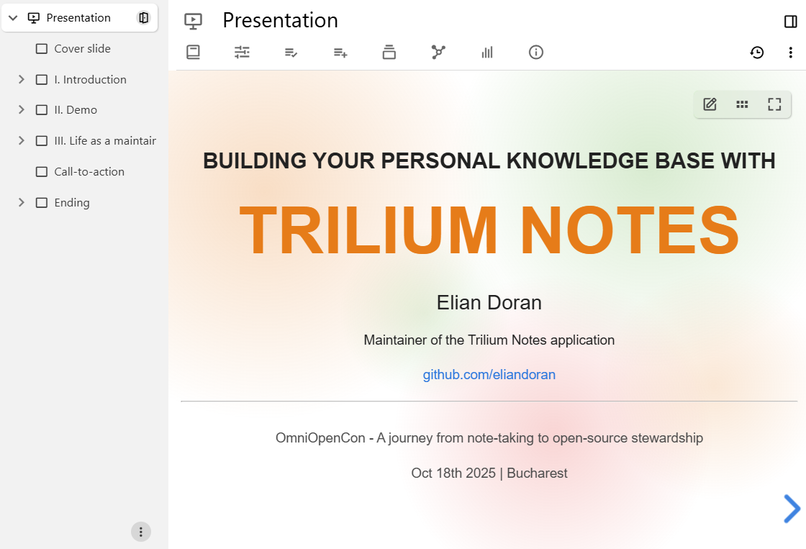
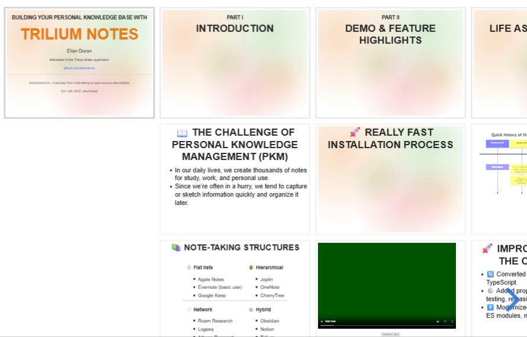

# 演示

<figure class="image"></figure>

演示视图允许直接在 Trilium 内创建幻灯片放映。

### 创建新演示

在<a class="reference-link" href="../Basic%20Concepts%20and%20Features/UI%20Elements/Note%20Tree.md">笔记树</a>中右键单击现有笔记，然后选择*插入子笔记* → *集合* → *演示*。

没有幻灯片的演示会在幻灯片和幻灯片侧边栏的位置显示一个 <span class="tn-icon bx bx-plus"></span> *新建幻灯片* 按钮，用于创建第一张幻灯片并开始编辑它。其旁边的箭头则用于创建其他类型的幻灯片，如下所述。只读演示只显示一条消息，说明它没有幻灯片。在存在幻灯片之前，*幻灯片侧边栏* 按钮处于禁用状态，幻灯片下方的控件也不会显示。

## 工作原理

*   每张幻灯片都是该集合的子笔记。
*   默认情况下，幻灯片不会显示在<a class="reference-link" href="../Basic%20Concepts%20and%20Features/UI%20Elements/Note%20Tree.md">笔记树</a>中，因为幻灯片侧边栏已经列出了它们（参见<a class="reference-link" href="../Basic%20Concepts%20and%20Features/UI%20Elements/Note%20Tree/Hiding%20the%20subtree.md">隐藏子树</a>）。要显示它们，请打开集合的 <span class="tn-icon bx bx-cog"></span> 设置并关闭*在树中隐藏子笔记*。
*   子笔记的顺序决定了幻灯片的顺序。
*   与传统演示软件不同，幻灯片可以水平或垂直布局（更多信息见下文）。
*   直接子级将水平布局，而这些子级的子级将垂直布局。超过两层嵌套的子级将被忽略。
*   <a class="reference-link" href="Kanban%20Board.md">看板</a>或<a class="reference-link" href="Table.md">表格</a>集合显示为一张幻灯片，其工作方式与在笔记本身中一样，因此其子级不会作为垂直幻灯片布局。其他集合则将其子级保留为垂直幻灯片。
*   幻灯片具有固定的 16:9 形状（1280×720）。笔记中的预览是全屏显示内容的缩小副本，因此能放入预览的内容在演示时也能放入。当窗口或屏幕形状不同时，幻灯片居中显示，周围带有黑边。
*   内容大于幻灯片的幻灯片会被缩小直到适应，包括文本。要保持文本较大，请将内容拆分到多张幻灯片上。

## 交互与导航

### 幻灯片侧边栏

幻灯片左侧的侧边栏以演示主题显示每张幻灯片的缩略图，垂直幻灯片缩进在其所属幻灯片下方。Web 视图、<a class="reference-link" href="Kanban%20Board.md">看板</a>和<a class="reference-link" href="Table.md">表格</a>幻灯片显示为图标。

*   正在显示的幻灯片带有轮廓，侧边栏会滚动以使其保持可见。
*   单击缩略图可转到其幻灯片。
*   要移动幻灯片，请拖动其缩略图；一条线会显示它将去往的位置。直接向上或向下拖动时，幻灯片保持其层级：
    *   顶层幻灯片会带着它的垂直幻灯片一起移动，拖到另一张幻灯片的垂直幻灯片上方时，它会排在整个堆栈之后。
    *   垂直幻灯片可以放到任何幻灯片的垂直幻灯片之间。放到没有垂直幻灯片的幻灯片下方时，它将成为该幻灯片的第一张垂直幻灯片，并且线条会缩进。
*   要更改幻灯片的层级，也请将其向侧面拖动：向右拖动使其成为垂直幻灯片，向左拖动使其成为顶层幻灯片。线条的缩进显示它将具有的层级。
    *   自身带有垂直幻灯片的幻灯片不能成为垂直幻灯片，<a class="reference-link" href="Kanban%20Board.md">看板</a>或<a class="reference-link" href="Table.md">表格</a>幻灯片也不能拥有垂直幻灯片。
*   在只读或基于搜索的演示中，或者拖入使用 `#sorted` 对其子级排序的笔记中时，无法拖动幻灯片。
*   一旦单击缩略图或用 <kbd>Tab</kbd> 到达缩略图，侧边栏将接管键盘，直到你单击幻灯片：
    *   按 <kbd>↑</kbd> 和 <kbd>↓</kbd> 按顺序转到上一张或下一张幻灯片，包括垂直幻灯片。
    *   按 <kbd>Home</kbd> 和 <kbd>End</kbd> 转到第一张或最后一张幻灯片。
    *   按 <kbd>Alt</kbd>+<kbd>↑</kbd> 和 <kbd>Alt</kbd>+<kbd>↓</kbd> 在其层级上将幻灯片向上或向下移动，越过整个垂直幻灯片堆栈。按 <kbd>Alt</kbd>+<kbd>→</kbd> 使其在原位置成为垂直幻灯片，按 <kbd>Alt</kbd>+<kbd>←</kbd> 使其成为顶层幻灯片（从右到左的语言中相反）。与拖动相同的限制适用。
*   右键单击缩略图，或在聚焦的缩略图上按 <kbd>Shift</kbd>+<kbd>F10</kbd> 或 <kbd>Menu</kbd> 键，以打开其上下文菜单。菜单打开时缩略图带有轮廓，正在显示的幻灯片不会改变：
    *   *编辑幻灯片* 转到该幻灯片并就地编辑它，如同双击一样。它适用于文本、<a class="reference-link" href="Kanban%20Board.md">看板</a>和<a class="reference-link" href="Table.md">表格</a>幻灯片。
    *   *打开笔记* 在新标签页、分屏或窗口中打开该幻灯片的笔记。
    *   *在此后新建幻灯片* 在其后、其层级上添加一张空幻灯片，*新建垂直幻灯片* 在其垂直幻灯片的末尾添加一张。每个都会询问幻灯片类型，列表与 *新建幻灯片* 按钮旁的箭头相同。演示会转到新幻灯片。*复制* 复制该幻灯片及其垂直幻灯片，紧接在其后。
    *   *上移*、*下移*、*设为垂直幻灯片* 和 *设为顶层幻灯片* 按照 <kbd>Alt</kbd> 和方向键的方式移动幻灯片。在幻灯片无法去往的位置，相应项会被禁用。
    *   *删除幻灯片...* 在请求确认后删除该幻灯片及其垂直幻灯片。
    *   只读演示仅提供 *打开笔记*。基于搜索的演示无法添加、移动或删除幻灯片。
*   要折叠侧边栏，请按幻灯片上方工具栏左侧、集合设置之后的 <span class="tn-icon bx bx-sidebar"></span> *幻灯片侧边栏* 按钮。再次按下可恢复侧边栏。每台设备会为每个演示记住该选择。
*   当笔记太窄而无法容纳侧边栏时，侧边栏会被隐藏。

### 幻灯片下方的控件

幻灯片下方有三组按钮。

#### 在幻灯片之间移动

左侧的 <span class="tn-icon bx bx-chevron-left"></span> *上一张幻灯片* 和 <span class="tn-icon bx bx-chevron-right"></span> *下一张幻灯片* 按钮按顺序浏览每张幻灯片，包括垂直幻灯片，如同 <kbd>Shift</kbd>+<kbd>Space</kbd> 和 <kbd>Space</kbd> 一样。它们之间是正在显示的幻灯片编号，以及幻灯片总数。

演示会在上次显示的幻灯片上打开，同步后在另一台设备上也是如此，除非该幻灯片已被删除。只读演示不会记住其幻灯片，而是在保存的幻灯片上打开，或者在第一张上打开。

#### 编辑

中间：

*   <span class="tn-icon bx bx-plus"></span> *新建幻灯片* 按钮，在正在显示的幻灯片之后、同一层级上添加一张空文本幻灯片：在一张幻灯片及其垂直幻灯片之后，或在垂直幻灯片之间。演示会转到新幻灯片并就地开始编辑它。其旁边的 <span class="tn-icon bx bx-chevron-down"></span> 箭头则添加其他类型的幻灯片：
    
    *   *文本* 和 <a class="reference-link" href="../Note%20Types/Canvas.md">画布</a> 排在最前，作为可以就地编辑的幻灯片；演示会开始编辑新幻灯片。
    *   <a class="reference-link" href="Kanban%20Board.md">看板</a>和<a class="reference-link" href="Table.md">表格</a>创建一个集合，使用与其他地方新建集合相同的模板，演示也会开始编辑它。
    *   <a class="reference-link" href="../Note%20Types/Mermaid%20Diagrams.md">Mermaid 图表</a>创建一个图表并在<a class="reference-link" href="../Basic%20Concepts%20and%20Features/Navigation/Quick%20edit.md">快速编辑</a>中打开以编写它。保存后幻灯片会显示该图表，<span class="tn-icon bx bx-edit"></span> *编辑此幻灯片* 按钮会再次在快速编辑中打开它。
    *   <a class="reference-link" href="../Note%20Types/Code.md">代码</a>打开一个列表，列出代码笔记选项中启用的代码语言，如同应用的其他笔记类型菜单一样，最后是 *配置代码笔记...* 以更改其提供的语言。新笔记在<a class="reference-link" href="../Basic%20Concepts%20and%20Features/Navigation/Quick%20edit.md">快速编辑</a>中打开以编写代码，如同 Mermaid 图表一样。
    *   *Web 视图* 和 *电子表格* 创建该类型的空笔记。其内容通过 <span class="tn-icon bx bx-edit"></span> *编辑此幻灯片* 按钮在<a class="reference-link" href="../Basic%20Concepts%20and%20Features/Navigation/Quick%20edit.md">快速编辑</a>中添加。
    
    [只读](../Basic%20Concepts%20and%20Features/Notes/Read-Only%20Notes.md)演示不显示它，由搜索生成的演示也不显示。
*   <span class="tn-icon bx bx-edit"></span> *编辑此幻灯片* 按钮用于编辑当前幻灯片：对于文本、画布、看板或表格幻灯片就地编辑，如同双击一样；对于任何其他类型的幻灯片，或在无法就地编辑幻灯片的情况下，则在<a class="reference-link" href="../Basic%20Concepts%20and%20Features/Navigation/Quick%20edit.md">快速编辑</a>中编辑。[只读](../Basic%20Concepts%20and%20Features/Notes/Read-Only%20Notes.md)演示不显示它。当幻灯片就地编辑时，该按钮变为 <span class="tn-icon bx bx-check"></span> *完成编辑* 按钮。
*   <span class="tn-icon bx bx-palette"></span> *幻灯片背景* 按钮用于选择当前幻灯片的背景颜色，或清除它以便幻灯片使用主题的背景。它不适用于覆盖整张幻灯片的 Web 视图、看板和表格幻灯片，只读演示也不显示它。仍可通过 `#slide:background` 标签设置渐变。

#### 查看

右侧：

*   按 <span class="tn-icon bx bx-grid-horizontal"></span> 概览按钮（或 <kbd>O</kbd> 键）以显示幻灯片的鸟瞰视图。再次按下该按钮可禁用它。
*   按 <span class="tn-icon bx bx-fullscreen"></span> *开始演示* 按钮（或 <kbd>F</kbd> 键）以全屏显示演示。按 <kbd>Esc</kbd> 或 <span class="tn-icon bx bx-exit-fullscreen"></span> *退出全屏* 按钮以离开。

在全屏中，编辑按钮被隐藏，另外两组在鼠标静止时淡出。移动鼠标可将其恢复。

### 键盘快捷键

以下键盘快捷键在演示为活动笔记时有效：在单击幻灯片或侧边栏之后，以及在全屏中。在其他分屏、笔记树或字段中按下的键会去往那里。

*   按 <kbd>←</kbd> 和 <kbd>→</kbd>（或 <kbd>H</kbd> 和 <kbd>L</kbd>）转到左侧或右侧的幻灯片（水平）。
*   按 <kbd>↑</kbd> 和 <kbd>↓</kbd>（或 <kbd>K</kbd> 和 <kbd>J</kbd>）转到向上或向下的幻灯片（垂直）。
*   按 <kbd>Space</kbd> 和 <kbd>Shift</kbd>+<kbd>Space</kbd> 按顺序转到下一张/上一张幻灯片。
*   按 <kbd>F</kbd> 以全屏开始演示。
*   还有更多，按 <kbd>?</kbd> 显示一个弹出窗口，其中包含所有支持的键盘组合。

## 就地编辑幻灯片

双击由文本笔记制成的幻灯片，以在幻灯片上、以演示的主题直接编辑它。虚线轮廓标记正在编辑的幻灯片，格式工具栏出现在所选文本旁边。更改会像在任何文本笔记中一样在键入时保存，超出幻灯片边缘的幻灯片会被缩小以适应。

要完成编辑，请按 <kbd>Esc</kbd>，按幻灯片下方的 <span class="tn-icon bx bx-check"></span> *完成编辑* 按钮，或转到另一张幻灯片。以全屏开始演示也会完成编辑，并且幻灯片无法在全屏中编辑。

<a class="reference-link" href="Kanban%20Board.md">看板</a>或<a class="reference-link" href="Table.md">表格</a>幻灯片在被编辑之前是只读的，这样在演示时卡片或单元格不会被意外更改，单击卡片或行也不会打开任何内容。双击它以像在其笔记中一样在幻灯片上编辑它，然后按 <span class="tn-icon bx bx-check"></span> *完成编辑* 按钮或转到另一张幻灯片以完成。集合上方的栏在幻灯片上没有视图类型切换器，并且仅在编辑幻灯片时显示 <span class="tn-icon bx bx-cog"></span> 设置。

双击<a class="reference-link" href="../Note%20Types/Canvas.md">画布</a>幻灯片以在其上就地绘制。画布编辑器覆盖演示，具有与画布笔记中相同的工具，并以幻灯片显示的大小和位置在绘图上打开。绘图会随操作保存。按 <kbd>Esc</kbd> 或 <span class="tn-icon bx bx-check"></span> *完成编辑* 按钮以完成。

其他笔记类型的幻灯片，例如图表，通过 <span class="tn-icon bx bx-edit"></span> *编辑此幻灯片* 按钮在<a class="reference-link" href="../Basic%20Concepts%20and%20Features/Navigation/Quick%20edit.md">快速编辑</a>中打开。[只读](../Basic%20Concepts%20and%20Features/Notes/Read-Only%20Notes.md)演示无法就地编辑，其自身笔记为只读的幻灯片也无法就地编辑。

## 垂直幻灯片与嵌套

与 Microsoft PowerPoint 等传统演示软件不同，Trilium 中的幻灯片可以水平或垂直布局，以创建深度或更好地按主题组织幻灯片。

这种水平/垂直组织会影响过渡（尤其是在“slide”过渡上），但它在导航中最为明显。

*   按 <kbd>←</kbd> 和 <kbd>→</kbd> 将水平浏览幻灯片，从而跳过当前幻灯片下的垂直笔记。这对于跳过整个章节/相关幻灯片很有用。
*   按 <kbd>↑</kbd> 和 <kbd>↓</kbd> 将在当前层级浏览垂直幻灯片。
*   按 <kbd>Space</kbd> 和 <kbd>Shift</kbd> + <kbd>Space</kbd> 将按顺序转到下一张/上一张幻灯片，无论方向如何。这通常是演示时使用的键组合。
*   幻灯片下方的 *上一张幻灯片* 和 *下一张幻灯片* 按钮按顺序移动，如同 <kbd>Space</kbd> 和 <kbd>Shift</kbd>+<kbd>Space</kbd> 一样。

<figure class="image image-style-align-right image_resized" style="width:55.57%;"></figure>

集合的所有直接子级将水平布局。如果直接子级还有子级，这些子级将作为垂直幻灯片放置。

在以下示例中，笔记结构如下：

*   演示集合
    *   Trilium Notes（演示页面）
    *   “简介”幻灯片
        *   “个人知识管理的挑战”
        *   “笔记结构”
    *   “演示与功能亮点”幻灯片
        *   “极快的安装过程”
        *   视频幻灯片

## 自定义

在集合级别，可以调整：

*   通过转到<a class="reference-link" href="Collection%20Properties.md">集合属性</a>并查找*主题*选项，将整个演示的主题调整为预定义主题之一。
*   目前无法创建自定义主题，但已计划。
*   请注意，无法通过<a class="reference-link" href="../Theme%20development/Custom%20app-wide%20CSS.md">自定义应用级 CSS</a>更改 CSS，因为幻灯片是隔离渲染的（在 shadow DOM 中）。

在幻灯片级别：

*   要更改幻灯片的背景颜色，请转到该幻灯片并使用工具栏中的 <span class="tn-icon bx bx-palette"></span> *幻灯片背景* 按钮，或将其笔记上的 `#slide:background` 设置为十六进制颜色。
*   更复杂的背景可以通过渐变实现。没有用于此的 UI；必须通过 `#slide:background` 设置为 CSS 渐变定义，例如：`linear-gradient(to bottom, #283b95, #17b2c3)`。

## 提示与技巧

*   文本笔记通常遵循格式（粗体、斜体、前景色和背景色）和字体大小。代码块和表格也可以使用。
*   尝试使用文本笔记之外的内容，演示使用与[共享笔记](../Advanced%20Usage/Sharing.md)和<a class="reference-link" href="../Basic%20Concepts%20and%20Features/Notes/Note%20List.md">笔记列表</a>相同的机制，因此它应该能够全屏显示<a class="reference-link" href="../Note%20Types/Mermaid%20Diagrams.md">Mermaid 图表</a>、<a class="reference-link" href="../Note%20Types/Canvas.md">画布</a>和<a class="reference-link" href="../Note%20Types/Mind%20Map.md">思维导图</a>（没有交互性）。
    *   <a class="reference-link" href="../Note%20Types/Canvas.md">画布</a>采用主题的浅色或深色样式，或幻灯片自身背景颜色的样式。
    *   <a class="reference-link" href="../Note%20Types/Code.md">代码</a>笔记填满幻灯片宽度，像在笔记中一样高亮显示。当代码主题跟随应用时，幻灯片使用浅色或深色代码主题以匹配演示的主题。长代码会被缩小以适应幻灯片。
    *   对于<a class="reference-link" href="../Note%20Types/Mermaid%20Diagrams.md">Mermaid 图表</a>，其中一些具有预定义背景，可以通过 frontmatter 更改。例如，对于 XY 图表：
        
        ```
        ---
        config:
            themeVariables:
                xyChart:
                    backgroundColor: transparent
        ---
        ```
*   <a class="reference-link" href="../Note%20Types/Web%20View.md">Web 视图</a>幻灯片在整个幻灯片上显示其页面，页面可以滚动，其链接可以单击。键盘仍由演示控制，因此单击页面后 <kbd>Space</kbd> 和方向键仍会切换幻灯片；要在页面中输入，请打开 Web 视图笔记本身。仅显示 `http://` 和 `https://` 地址。它的工作方式与 Web 视图笔记本身相同，因此在桌面应用程序之外，某些网站会拒绝显示。

## 底层实现

演示视图使用 [Reveal.js](https://revealjs.com/) 来处理幻灯片的导航和布局。