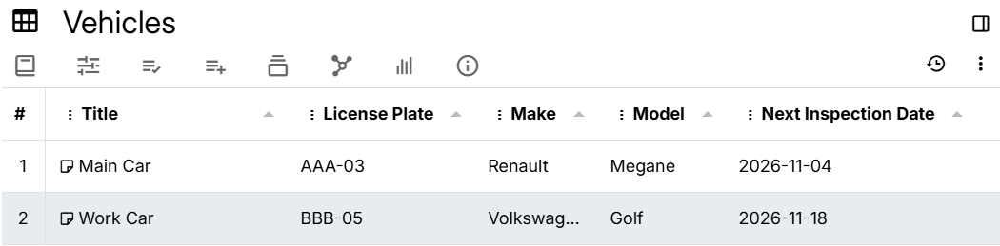

# 表格
<figure class="image"></figure>

表格视图以网格形式显示信息，其中行是各个笔记，列是<a class="reference-link" href="../Advanced%20Usage/Attributes/Promoted%20Attributes.md">提升属性</a>。此外，值是可编辑的。

## 工作原理

表格结构表示如下：

*   每个子笔记都是表格中的一行。
*   如果子行也有子笔记，它们将显示在展开器下（嵌套笔记）。
*   每一列都是在集合笔记上定义的[提升属性](../Advanced%20Usage/Attributes/Promoted%20Attributes.md)。
    *   实际上，提升属性和非提升属性都受支持，但要求使用标签/关系定义。
    *   提升属性通常定义为可继承，以便在子笔记中显示，但这并非必需。
*   如果有多个具有相同 `name` 的属性定义，则只显示一个。
*   如果属性定义有多个值，它们将全部归组在单个列下，并用标签块指示各个值。

还有一些预定义的列：

*   当前项目编号，由 `#` 符号标识。
    *   这只是对笔记进行计数，并受排序影响。
*   <a class="reference-link" href="../Advanced%20Usage/Note%20ID.md">笔记 ID</a>，表示 Trilium 内部使用的唯一 ID
*   笔记的标题。
*   _创建_ 和 _修改_，即笔记创建和最后修改的日期和时间。这些列默认隐藏且不可编辑；从列上下文菜单中显示它们，然后点击其表头以按它们排序。

## 交互

### 创建新表格

在<a class="reference-link" href="../Basic%20Concepts%20and%20Features/UI%20Elements/Note%20Tree.md">笔记树</a>中右键单击现有笔记，然后选择 _插入子笔记_ → _集合_ → _表格_。

### 添加列

每一列都是在集合笔记上定义的[提升或非提升属性](../Advanced%20Usage/Attributes/Promoted%20Attributes.md)。

要创建新列，可以：

*   按表格底部的 _添加新列_。
*   右键单击现有列，然后选择向左/向右添加列。
*   右键单击列标题的空白区域，然后在 _新列_ 部分选择 _标签_ 或 _关系_。

### 添加新行

每一行实际上都是集合笔记的子笔记。

要创建新笔记，可以：

*   按表格底部的 _添加新行_。
*   右键单击现有行，然后选择 _在上方插入行_、_插入子笔记_ 或 _在下方插入行_。

默认情况下，它会尝试编辑新创建笔记的标题。

或者，也可以从<a class="reference-link" href="../Basic%20Concepts%20and%20Features/UI%20Elements/Note%20Tree.md">笔记树</a>或[脚本](../Scripting.md)创建笔记。

### 上下文菜单

有多个菜单：

*   右键单击列，可以：
    *   按所选列排序并重置排序。
    *   隐藏所选列或调整每一列的可见性。
    *   在列的左侧或右侧添加新列。
    *   编辑当前列。
    *   删除当前列。
*   右键单击列右侧的空白区域，可以：
    *   调整每一列的可见性。
    *   添加新列。
*   右键单击行，可以：
    *   在新标签页、分屏、窗口或快速编辑中打开该行对应的笔记。
    *   在所选行的上方或下方插入新笔记。仅当表格未排序时这些选项才启用。
    *   为所选行插入新的子笔记。
    *   删除该行。

### 打开笔记

将鼠标悬停在行上时，其标题末尾会显示一个 _打开_ 按钮，可在快速编辑中打开该笔记。在触摸屏上，该按钮始终可见。

点击标题本身则会重命名笔记（见下文）。要在其他位置打开笔记：

*   <kbd>Ctrl</kbd>+单击或中键单击标题，在新标签页中打开笔记。
*   <kbd>Shift</kbd>+单击标题，在新窗口中打开它。
*   右键单击行，在新标签页、分屏或窗口中打开笔记，或在快速编辑中打开。

### 编辑数据

只需单击行中的单元格即可更改其值。更改不仅会反映在表格中，还会反映为相应笔记的属性。

*   编辑将遵循提升属性的类型，例如显示普通文本框、数字选择器或日期选择器。
*   布尔值列显示一个复选框，单击一次即可选中或取消选中。没有该标签的笔记显示未选中的框。
*   也可以通过单击笔记的标题来更改其标题。
*   也可以编辑关系
    *   只需单击关系，它就会变为可编辑状态。输入要查找的笔记文本，然后单击它。
    *   要移除关系，请从文本框中删除笔记的标题，然后单击单元格外部。

### 编辑列

可以通过右键单击列并选择 _编辑列…_ 来编辑列。这基本上会更改集合级别的标签/关系定义。

打开 _多个值_ 可让每个笔记在该列中保存多个值。然后单元格会将它们显示为标签块（参见提升属性中的[多个值](../Advanced%20Usage/Attributes/Promoted%20Attributes.md)）。添加列时也可使用相同的开关。

如果更改了列的 _名称_ 字段，将触发批量操作，在所有子笔记中重命名相应的标签/关系。

### 只读表格

在[只读](../Basic%20Concepts%20and%20Features/Notes/Read-Only%20Notes.md)表格上，单元格不可编辑，行不可拖动。单击笔记的标题会在快速编辑中打开它，因此没有 _打开_ 按钮。_新行_ 和 _新列_ 按钮被隐藏，上下文菜单仅提供保持笔记原样的操作：排序和隐藏列，以及打开笔记。列仍可调整大小和重新排序，但布局不会被保存。_表格属性_ 对话框不可用。

## 处理数据

### 按列排序

默认情况下，笔记的顺序与<a class="reference-link" href="../Basic%20Concepts%20and%20Features/UI%20Elements/Note%20Tree.md">笔记树</a>中的顺序一致。但是，可以按列的值对数据排序：

*   为此，只需单击列。
*   要在升序或降序排序之间切换，只需再次单击同一列。列旁边的箭头将指示排序方向。在未排序的列上，箭头仅在悬停在其表头上时出现。
*   要禁用排序并恢复原始顺序，请右键单击表头上的任意列，然后选择 _清除排序。_

### 重新排序和隐藏列

*   可以通过拖动列的表头来重新排序列。
*   可以通过右键单击列并单击与该列对应的项来隐藏或显示列。

### 重新排序行

可以拖动笔记来更改其顺序。为此，将鼠标移到编号行附近的三条垂直点上方，然后将鼠标拖到所需位置。

这也会更改笔记在<a class="reference-link" href="../Basic%20Concepts%20and%20Features/UI%20Elements/Note%20Tree.md">笔记树</a>中的顺序。

重新排序确实有一些限制：

*   如果父笔记具有 `#sorted`，则重新排序将被禁用。
*   如果使用嵌套表格，则重新排序也将被禁用。
*   目前，即使使用列排序，也可以重新排序笔记，但结果可能不一致。

### 嵌套树

如果集合的子笔记也有自己的子笔记，那么它们将以层级结构显示。

每个元素的标题旁边都会有一个展开或折叠按钮。默认情况下，所有项目都展开。

由于嵌套并不总是可取的，因此可以将嵌套限制在特定层数，甚至完全禁用。为此，请转到<a class="reference-link" href="../Basic%20Concepts%20and%20Features/UI%20Elements/Note%20menu.md">笔记菜单</a> → _表格属性_ 并设置 _最大嵌套深度_（在 _包含的笔记_ 部分下），或设置集合的 `#maxNestingDepth` [标签](../Advanced%20Usage/Attributes/Labels.md)：

*   `0` 禁用嵌套，仅显示集合的子笔记。
*   `1` 还会显示它们的子笔记，`2` 显示再下一层，依此类推。
*   移除该标签会再次显示所有层级。

限制：

*   在此模式下，无法重新排序笔记。

## 限制

*   不支持按特定条件筛选行。对于该用例，请考虑在搜索中使用表格视图；例如，`note.dateCreated >= TODAY-7` 列出过去一周创建的笔记。

## 在搜索中使用

通过在<a class="reference-link" href="../Note%20Types/Saved%20Search.md">保存的搜索</a>中添加 `#viewType=table` 属性，可以在其中使用表格视图。

与在集合中使用时不同，保存的搜索不限于笔记的子层级，并且借助<a class="reference-link" href="../Basic%20Concepts%20and%20Features/Navigation/Search.md">搜索</a>的强大功能，允许进行高级查询。

但是，也有一些限制：

*   无法重新排序笔记。
*   无法添加新行。

支持列，方法是在<a class="reference-link" href="../Note%20Types/Saved%20Search.md">保存的搜索</a>笔记上将其定义为<a class="reference-link" href="../Advanced%20Usage/Attributes/Promoted%20Attributes.md">提升属性</a>。

也支持编辑。