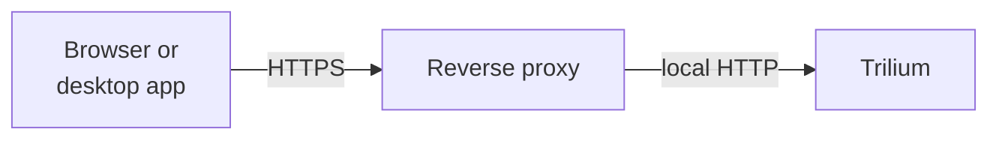

# 2. 反向代理
Trilium 通常通过**反向代理**暴露到互联网，由反向代理处理 TLS 终止、提供单一公网入口，并（可选地）让你在一个域名下托管多个实例。Trilium 本身仍在其本地端口上以纯 HTTP 运行；代理位于其前方。



本节收集了针对特定服务提供商的指南，以及无论使用哪种代理都适用的配置。

## 服务提供商指南

*   <a class="reference-link" href="2.%20Reverse%20proxy/Nginx.md">Nginx</a>
*   <a class="reference-link" href="2.%20Reverse%20proxy/Traefik.md">Traefik</a>
*   <a class="reference-link" href="2.%20Reverse%20proxy/Apache%20using%20Docker.md">使用 Docker 的 Apache</a>

## 适用于所有代理

无论你选择哪种代理，请确保以下几点：

*   **转发 WebSocket 升级。** Trilium 使用 WebSocket 进行同步和实时 UI 更新。你的代理必须透传 `Upgrade` 和 `Connection` 头，否则客户端看起来已加载，但永远不会收到更新。
*   **配置受信任的代理。** 以便 Trilium 看到真实的客户端 IP（用于速率限制、日志记录和安全 Cookie），而不是代理的地址。参见 <a class="reference-link" href="2.%20Reverse%20proxy/Trusted%20proxy.md">受信任的代理</a>。
*   **在代理处终止 TLS。** 参见 <a class="reference-link" href="HTTPS%20(TLS).md">HTTPS (TLS)</a>。

## 在 Trilium 前方放置身份验证代理

某些部署会在代理处放置一个**前向认证 / SSO 层**（Authelia、Authentik、oauth2-proxy 或 OIDC 插件），以便*每个*请求都必须先通过交互式登录。

这会**破坏同步和初始设置。** 同步是一个在后台无人值守运行的机器对机器过程——它没有浏览器，无法完成交互式登录挑战。当代理拦截同步请求时，它会返回 HTML 登录页面而不是预期的 JSON，客户端会失败并报错，例如：

```
Sync failed: Request to GET https://trilium.example.com/api/setup/status failed,
error: Unexpected token '<', "<!doctype "... is not valid JSON

```

有两种方法可以解决此问题：

*   **首选方案，使用 Trilium 内置的身份验证。** 完全不要在代理处对 Trilium 设限。Trilium 可以自行对 Web 界面进行身份验证，包括通过 [OpenID Connect](Signing%20in%20with%20OpenID%20Connect.md)。这样同步端点就可以按其设计方式进行身份验证。
*   **将同步端点从前向认证中豁免。** 如果你必须将身份验证保留在代理处，请从代理的前向认证检查中排除以下路径：
    *   `/api/setup/*`
    *   `/api/login/sync`
    *   `/api/sync/*`

> [!NOTE]
> 这是安全的：Trilium 会自行对这些端点进行身份验证。同步使用基于共享密钥的无挑战 HMAC 握手，而一次性设置种子请求受密码保护——因此在代理处豁免它们不会将你的数据暴露给未经身份验证的访问。

以下是一个 Nginx 示例，其中 `/auth` 是你的前向认证端点：

```
server {
    # ... TLS, server_name, etc. ...

    # Sync and setup endpoints authenticate themselves — skip forward-auth.
    location ~ ^/api/(sync|login/sync|setup) {
        auth_request off;
        proxy_set_header Host $host;
        proxy_set_header X-Real-IP $remote_addr;
        proxy_set_header X-Forwarded-For $proxy_add_x_forwarded_for;
        proxy_set_header X-Forwarded-Proto $scheme;
        proxy_set_header Upgrade $http_upgrade;
        proxy_set_header Connection "upgrade";
        proxy_pass http://trilium;
    }

    # Everything else goes through forward-auth.
    location / {
        auth_request /auth;
        proxy_set_header Host $host;
        proxy_set_header X-Real-IP $remote_addr;
        proxy_set_header X-Forwarded-For $proxy_add_x_forwarded_for;
        proxy_set_header X-Forwarded-Proto $scheme;
        proxy_set_header Upgrade $http_upgrade;
        proxy_set_header Connection "upgrade";
        proxy_pass http://trilium;
    }
}
```