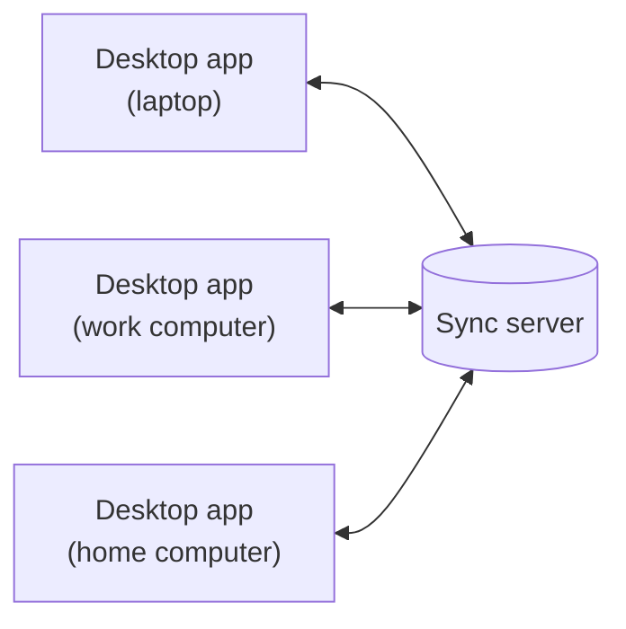
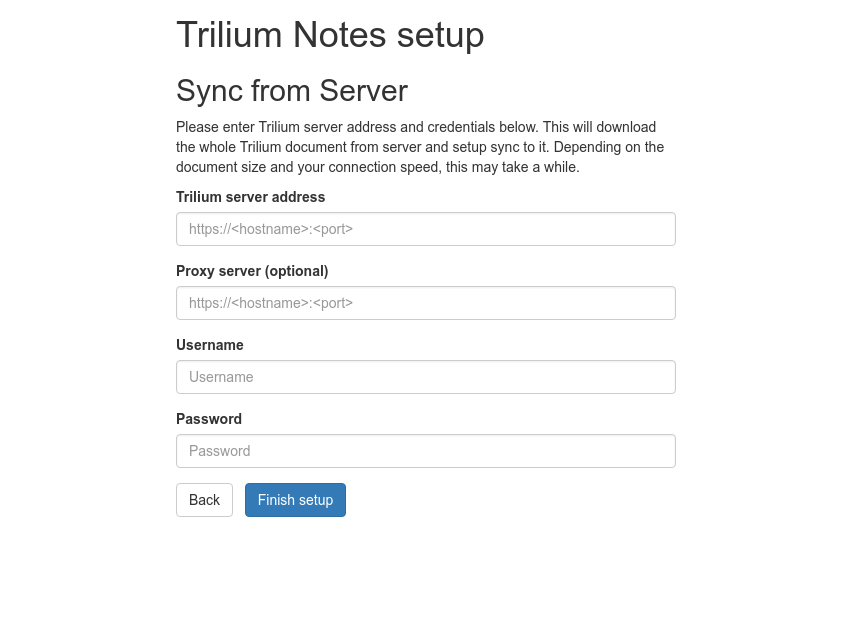
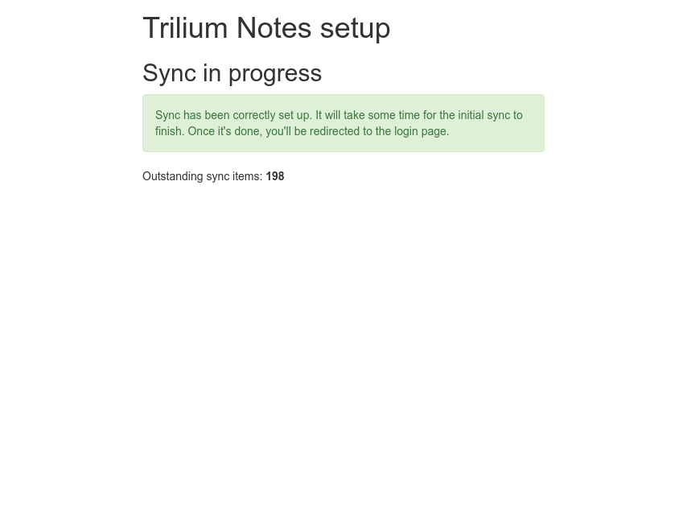
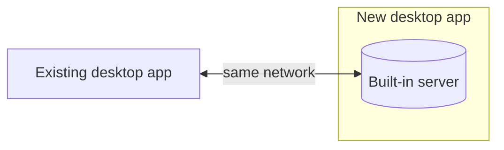

# 同步

Trilium 是一款离线优先的笔记应用，所有数据都存储在桌面客户端本地。不过，它也提供了与服务器实例建立同步的选项，允许多个桌面客户端与一个中央服务器同步。这形成了一种星形拓扑结构：



在这种设置中，一个中央服务器（称为*同步服务器*）和多个*客户端*（或*桌面*）实例与同步服务器进行同步。配置完成后，同步会自动持续进行，无需人工干预。

## 设置同步

### 安全注意事项

安全地设置服务器至关重要，而且可能很复杂。务必使用有效的 [TLS 证书](Server%20Installation/HTTPS%20\(TLS\).md)（HTTPS），而不是未加密的 HTTP 连接，以确保安全性并避免潜在漏洞。

### 将桌面实例与同步服务器同步

当你已经拥有一个 Trilium 桌面实例，并希望在 Web 主机上设置同步服务器时，使用此方法。

1.  **服务器部署**：确保你的服务器实例已部署但尚未初始化。
2.  **桌面配置**：打开你的桌面实例，导航到 <a class="reference-link" href="../Basic%20Concepts%20and%20Features/UI%20Elements/Options.md">选项</a> → *同步* → *同步服务器*，将*服务器地址*设置为你的同步服务器地址。
    *   请注意，同步服务器也可以通过 <a class="reference-link" href="../Advanced%20Usage/Configuration%20(config.ini%20or%20environment%20variables).md">配置（config.ini 或环境变量）</a>覆盖，在这种情况下，该值优先。如果是这种情况，会有一个名为*正在使用的服务器*的字段来指示。
3.  **测试同步**：点击*测试同步*按钮以验证与同步服务器的连接。
    *   如果成功，客户端将开始将所有数据推送到服务器实例。
    *   此过程可能需要一些时间，但你可以继续使用 Trilium。定期检查服务器实例以确认同步何时完成。完成后，你应该能在服务器上看到登录界面。

### 从同步服务器同步桌面实例

当你已经拥有一个同步服务器，并希望配置一个新的桌面实例与其同步时，使用此方法。

1.  **桌面设置**：按照[桌面安装页面](Desktop%20Installation.md)进行操作。
2.  **初始配置**：在提示时，选择与同步服务器设置同步的选项。



1.  **服务器详情**：配置 Trilium 服务器地址并输入服务器密码。如果服务器启用了 <a class="reference-link" href="Server%20Installation/Multi-factor%20authentication%20with%20TOTP.md">基于 TOTP 的多因素身份验证</a>，还需输入身份验证器应用中的一次性密码或恢复代码。
2.  **完成设置**：点击“完成设置”按钮。如果成功，你将看到以下界面：



同步完成后，你将自动重定向到 Trilium 应用。

### 桌面到桌面同步

此方法允许两个桌面实例相互同步，而无需 <a class="reference-link" href="Server%20Installation.md">服务器安装</a>。

每个桌面应用都包含一个内置服务器。在这种设置中，新的桌面实例使用该服务器作为现有实例的同步服务器，因此每当另一个实例同步时，它必须处于运行状态并可通过网络访问。两台设备必须位于同一网络。



1.  **新桌面**：在首次启动时，在设置界面中选择*连接桌面应用*。页面会列出*此设备的地址*并等待连接。
2.  **网络访问**：如果页面提示其他设备无法访问该设备，请选择*允许网络访问并重启*。Trilium 将重启，之后你再次选择*连接桌面应用*。
3.  **现有桌面**：打开 <a class="reference-link" href="../Basic%20Concepts%20and%20Features/UI%20Elements/Options.md">选项</a> → *同步*，将*服务器地址*设置为新桌面上显示的地址之一（例如 `http://192.168.0.10:37840`），然后选择*立即测试*。
4.  **初始同步**：新桌面会显示同步进度，并在完成后打开知识库。此后，现有桌面会持续与新桌面同步。

> [!WARNING]
> 自 v0.104.0 起，需要启用局域网访问才能让此同步正常工作。有关如何操作的信息，请参阅 <a class="reference-link" href="Desktop%20Installation/Network%20Access.md">网络访问</a>。

## 代理配置

支持两种代理设置：

*   **显式代理配置**：在选项 / 同步中设置代理服务器。仅支持无需身份验证的代理服务器。
*   **系统代理设置**：如果未显式配置代理服务器，Trilium 将使用系统代理设置。

## 故障排除

### 日期/时间同步

为确保同步成功，客户端和服务器必须具有相同的日期和时间，容差最多为五分钟。

### 证书问题

使用 TLS 时，Trilium 会验证服务器证书。如果验证失败（例如由于自签名证书或某些企业代理），你可以将 `NODE_TLS_REJECT_UNAUTHORIZED` 环境变量设置为 `0` 来运行 Trilium 客户端：

```
export NODE_TLS_REJECT_UNAUTHORIZED=0
```

这将禁用 TLS 证书验证，显著降低安全性并使设置面临中间人攻击的风险。强烈建议使用有效的已签名服务器证书。较新的 Trilium 版本包含一个名为 `trilium-no-cert-check.sh` 的脚本用于此目的。

### 冲突解决

如果你在同步之前于多个实例上编辑了同一笔记，Trilium 会通过保留较新的更改并丢弃较旧的更改来解决冲突。较旧的版本仍可在[笔记修订](../Basic%20Concepts%20and%20Features/Notes/Note%20Revisions.md)中访问，以便在需要时恢复数据。

### 哈希校验

每次同步后，Trilium 会在客户端和同步服务器上计算所有已同步数据的哈希值。如果存在差异，Trilium 将自动启动恢复机制来解决问题。