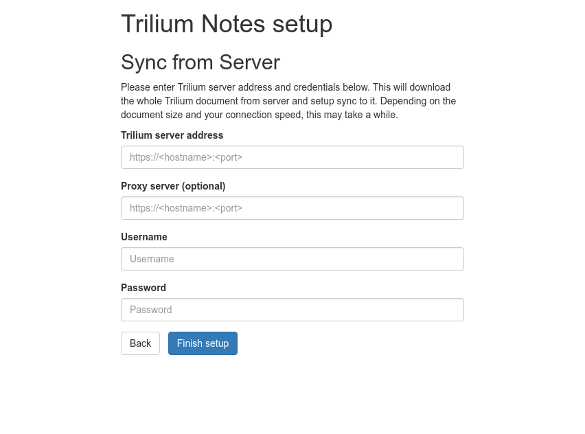
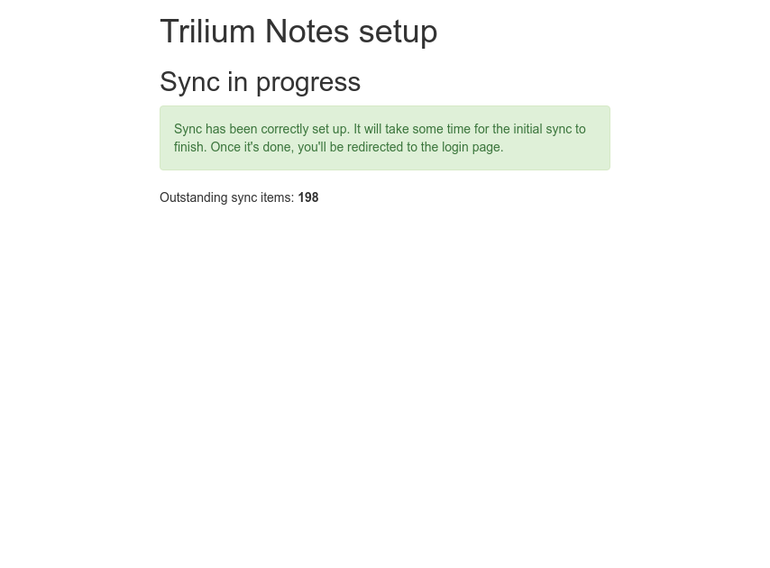

# 同步

Trilium 是一款离线优先的笔记应用，所有数据都存储在桌面客户端本地。不过，它也提供了与服务器实例建立同步的选项，允许多个桌面客户端与中央服务器同步。这形成了一种星形拓扑结构：


在此设置中，一个中央服务器（称为*同步服务器*）和多个*客户端*（或*桌面*）实例与同步服务器进行同步。配置完成后，同步会自动持续进行，无需手动干预。

## 设置同步

### 安全注意事项

安全地设置服务器至关重要，且可能较为复杂。使用有效的 [TLS 证书](Server%20Installation/HTTPS%20\(TLS\).md)（HTTPS）而非未加密的 HTTP 连接对于确保安全性和避免潜在漏洞至关重要。

### 将桌面实例与同步服务器同步

此方法适用于您已有 Trilium 桌面实例，并希望在 Web 主机上设置同步服务器的情况。

1.  **服务器部署**：确保您的服务器实例已部署但尚未初始化。
2.  **桌面配置**：打开您的桌面实例，导航至 <a class="reference-link" href="../Basic%20Concepts%20and%20Features/UI%20Elements/Options.md">选项</a> → _同步_ → _同步服务器_，将_服务器地址_设置为您的同步服务器地址。
    *   请注意，同步服务器也可以通过 <a class="reference-link" href="../Advanced%20Usage/Configuration%20(config.ini%20or%20environment%20variables).md">配置（config.ini 或环境变量）</a> 覆盖，此时该值优先。如果是这种情况，会出现一个名为_正在使用的服务器_的字段来指示。
3.  **测试同步**：点击_测试同步_按钮以验证与同步服务器的连接。
    *   如果成功，客户端将开始将所有数据推送到服务器实例。
    *   此过程可能需要一些时间，但您可以继续使用 Trilium。定期检查服务器实例以确认同步何时完成。完成后，您应该会在服务器上看到登录界面。

### 从同步服务器同步桌面实例

此方法适用于您已有同步服务器，并希望配置新的桌面实例与其同步的情况。

1.  **桌面设置**：按照[桌面安装页面](Desktop%20Installation.md)进行操作。
2.  **初始配置**：在提示时，选择与同步服务器设置同步的选项。



1.  **服务器详情**：配置 Trilium 服务器地址，并输入正确的用户名和密码进行身份验证。
2.  **完成设置**：点击“完成设置”按钮。如果成功，您将看到以下界面：



同步完成后，您将自动重定向到 Trilium 应用。

### 桌面到桌面同步

此方法允许两个桌面实例之间相互同步，无需 <a class="reference-link" href="Server%20Installation.md">服务器安装</a>。

> [!WARNING]
> 自 v0.104.0 起，需要启用局域网访问才能让此同步功能正常工作。请参阅 <a class="reference-link" href="Desktop%20Installation/Network%20Access.md">网络访问</a> 了解如何操作。

## 代理配置

支持两种代理设置：

*   **显式代理配置**：在选项 / 同步中设置代理服务器。仅支持无需身份验证的代理服务器。
*   **系统代理设置**：如果未显式配置代理服务器，Trilium 将使用系统代理设置。

## 故障排除

### 日期/时间同步

为确保同步成功，客户端和服务器必须具有相同的日期和时间，容差最多为五分钟。

### 证书问题

使用 TLS 时，Trilium 会验证服务器证书。如果验证失败（例如，由于自签名证书或某些企业代理），您可以在运行 Trilium 客户端时将 `NODE_TLS_REJECT_UNAUTHORIZED` 环境变量设置为 `0`：

```
export NODE_TLS_REJECT_UNAUTHORIZED=0
```

这将禁用 TLS 证书验证，显著降低安全性并使设置暴露于中间人攻击。强烈建议使用有效的签名服务器证书。较新的 Trilium 版本包含一个名为 `trilium-no-cert-check.sh` 的脚本用于此目的。

### 冲突解决

如果您在同步之前在多个实例上编辑了同一笔记，Trilium 会通过保留较新的更改并丢弃较旧的更改来解决冲突。较旧的版本仍可在[笔记修订](../Basic%20Concepts%20and%20Features/Notes/Note%20Revisions.md)中访问，以便在需要时恢复数据。

### 哈希校验

每次同步后，Trilium 会在客户端和同步服务器上计算所有已同步数据的哈希值。如果存在差异，Trilium 将自动启动恢复机制来解决问题。