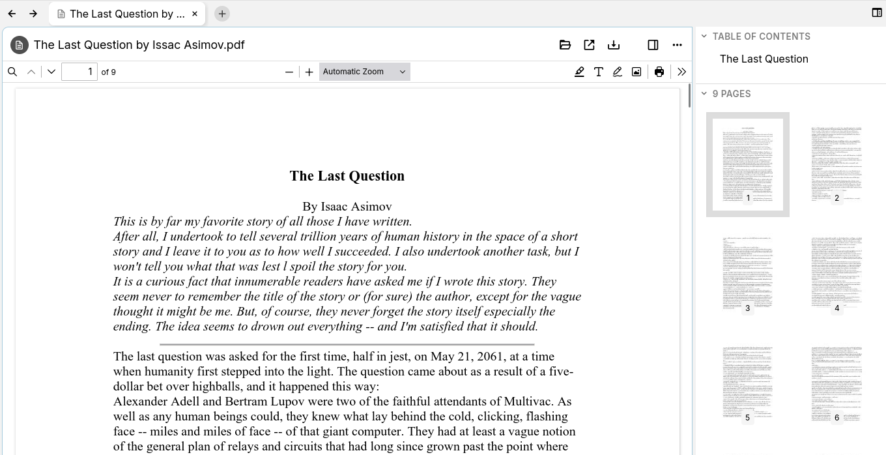

# PDF

<figure class="image image_resized" style="width:74.34%;"></figure>

PDF 文件可以上传到 Trilium 中，无需先下载即可直接显示。

自 v0.102.0 起，PDF 将使用 Trilium 内置的 PDF 查看器进行渲染，该查看器是对 [Mozilla 的 PDF.js 查看器](https://mozilla.github.io/pdf.js/)（同样内置于 Mozilla Firefox 浏览器中）的定制版本。在此之前的版本使用浏览器默认的 PDF 查看器来渲染 PDF。

## 功能

*   上次查看的页面和滚动位置会在重启或笔记导航之间保持不变。
*   注释（文本、高亮）以及评论。这些内容会自动保存。
*   可以填写表单。
*   可以打印或下载。
*   可以保存为[模板](../../Advanced%20Usage/Templates.md)，PDF 的内容将被复制到新笔记中。这在结合注释或已填写的表单时尤为有用。
*   与<a class="reference-link" href="../../Basic%20Concepts%20and%20Features/UI%20Elements/Right%20Sidebar.md">右侧边栏</a>集成，显示带缩略图的页面列表、目录以及注释列表。
*   对签名（手绘签名，而非正式的数字签名）提供基本支持，类似于注释。签名会被存储，并可在多个文档之间重复使用（最多 5 个）。

## 存储上次位置和设置

对于每个 PDF，Trilium 会记住以下信息：

*   当前页面。
*   当前页面内的滚动位置。
*   页面的旋转角度。

这在阅读大型文档时非常有用，因为位置会被自动记住。此过程在后台进行，但仅在停止滚动操作几秒后才会记录。

> [!TIP]
> 从技术上讲，滚动位置和旋转角度的信息存储在<a class="reference-link" href="../../Basic%20Concepts%20and%20Features/Notes/Attachments.md">附件</a>区域中，位于一个名为 `pdfHistory.json` 的专用附件里。

## 注释

自 v0.102.0 起，可以为 PDF 添加注释。为此，请查找 PDF 工具栏右侧的注释按钮（）。

自 v0.103.0 起：

*   如果笔记被标记为<a class="reference-link" href="../../Basic%20Concepts%20and%20Features/Notes/Read-Only%20Notes.md">只读笔记</a>，注释功能将被禁用。
*   还可以添加评论，评论类似于高亮，但会附带文本。
*   <a class="reference-link" href="../../Basic%20Concepts%20and%20Features/UI%20Elements/Right%20Sidebar.md">右侧边栏</a>也会显示注释列表（高亮、评论）。

### 支持的注释

支持以下注释方式：

*   **高亮**  
    允许使用预定义颜色之一来高亮文本。
    *   粗细也可调整。
    *   还可以高亮空白区域，使该功能更像一支更粗的笔。
*   **文本**  
    允许添加任意文本，可自定义颜色和大小。
*   **画笔**  
    允许在文档上自由绘制，可调整颜色、粗细和透明度。
*   **图片**  
    允许将来自 Trilium 外部的图片直接插入文档中。

### 编辑现有注释

尽管注释存储在 PDF 本身中，但它们是可以编辑的。要编辑注释，请按上一节中的某个注释按钮进入编辑模式，然后点击现有注释。这将显示一个工具栏，其中包含自定义注释的选项（例如更改颜色），以及删除注释的功能。

### 注释如何存储

注释直接存储在 PDF 中。进行修改时，Trilium 会用新的 PDF 替换旧的 PDF。

由于修改会自动保存，因此在修改注释后无需手动保存文档。

“内嵌注释”的好处是，如果下载（在 Trilium 外部使用）或分享笔记，它们也是可访问的。

缺点是整个 PDF 需要发送回服务器，这可能会降低大型文档的性能。如果您遇到此系统的任何问题，请随时[报告](../../Troubleshooting/Reporting%20issues.md)。

## 链接到标题

自 v0.108.0 起，链接可以指向 PDF 的某个标题：即文件定义的大纲条目，也就是<a class="reference-link" href="../../Basic%20Concepts%20and%20Features/UI%20Elements/Right%20Sidebar.md">右侧边栏</a>目录中列出的相同标题。要从文本或 Markdown 笔记创建此类链接：

*   在*添加链接*对话框中，在*笔记*页面选择该 PDF。其标题会列在*链接标题*下方，位于*链接到标题*之下。勾选一个，然后按 <kbd>Enter</kbd> 或*插入链接*。
*   或者，输入 `@` 并选择该 PDF：菜单随后会列出相同的标题。

要在阅读 PDF 时复制指向标题的链接，请右键点击<a class="reference-link" href="../../Basic%20Concepts%20and%20Features/UI%20Elements/Right%20Sidebar/Outline%20tab.md">大纲标签页</a>目录中的标题，然后选择*复制引用*。

该链接显示 PDF 的标题，后跟标题的名称，并打开 PDF 到该标题处。它还携带标题所在的页码，当找不到该标题时（例如文件的大纲已更改），PDF 会打开到该页码。如果某个标题的名称在其相邻标题中重复出现，则只会在同一文件中被找到，因此一旦 PDF 再次保存（例如添加了新注释），指向它的链接将打开其所在页面。

要链接到 PDF 附件的标题，请编辑指向该附件的链接：对话框会列出该附件的标题。

> [!NOTE]
> Trilium 将每个 PDF 的标题保存在笔记的一个名为 `toc-cache.json` 的附件中，每当文件更改时都会重新读取。笔记的修订版本、导出和副本不会包含它。在独立（浏览器）和移动版本上，PDF 的标题仅在 PDF 被打开后才会列出，因为在那里是由 PDF 查看器读取它们。

## 链接到页面或注释

链接可以打开 PDF 到指定页面，或到其某个注释处。要创建此类链接：

*   要链接到页面，请右键点击<a class="reference-link" href="../../Basic%20Concepts%20and%20Features/UI%20Elements/Right%20Sidebar.md">右侧边栏</a>的*页面*区域中的页面，然后选择*复制引用*。
*   要链接到注释，请右键点击侧边栏*注释*区域中的注释，然后选择*复制引用*。

粘贴到文本笔记中后，该引用会成为<a class="reference-link" href="../Text/Links/Internal%20(reference)%20links.md">内部（引用）链接</a>之一，显示 PDF 的标题，后跟页码（*第 5 页*），或者对于注释引用则显示*第 5 页上的注释*。点击它会打开 PDF 并滚动到该页面或该注释处。

指向注释的引用也会携带其页码，因此指向已删除注释的链接仍会打开正确的页面。

> [!NOTE]
> 自 PDF 打开以来绘制的注释在 PDF 再次打开之前没有永久标识符，因此为其复制的引用仅指向其所在页面。

## 填写表单

与注释类似，Trilium 自 v0.102.0 起也支持表单。如果文档中有可填写的字段，它们将以彩色背景标示。

只需在表单中输入文本，它们就会被自动保存。

## 侧边栏导航

请参阅<a class="reference-link" href="../../Basic%20Concepts%20and%20Features/UI%20Elements/Right%20Sidebar/Outline%20tab.md">大纲标签页</a>中关于 PDF 的专门章节。

## 分享功能

PDF 也可以使用<a class="reference-link" href="../../Advanced%20Usage/Sharing.md">分享</a>功能进行分享。这同样会使用 Trilium 定制的 PDF 查看器。

如果您在服务器上使用反向代理，并对分享功能设置了严格的访问限制，请确保 `[host].com/pdfjs` 目录可访问。请注意，该目录位于 `/share` 路由之外，这与应用程序其余部分的常见情况一致。

## OCR

PDF 符合<a class="reference-link" href="../../Advanced%20Usage/Text%20Extraction%20(OCR).md">文本提取（OCR）</a>的条件，这意味着其文本可用于<a class="reference-link" href="../../Basic%20Concepts%20and%20Features/Navigation/Search.md">搜索</a>。