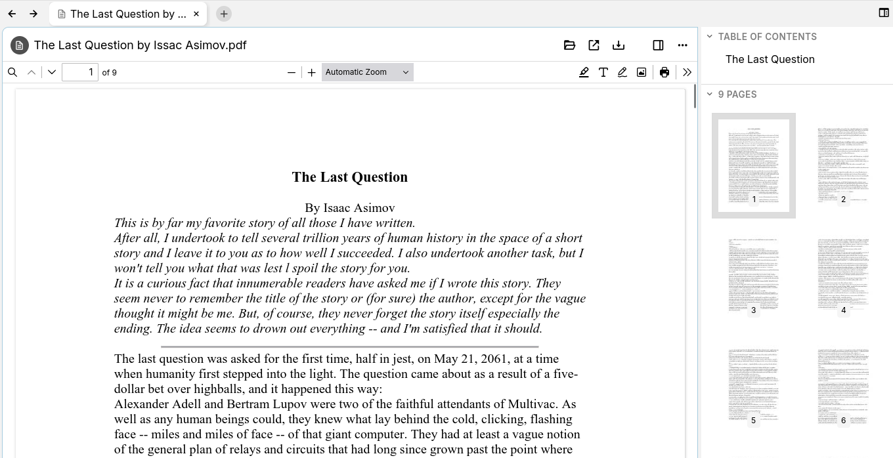

# PDF

<figure class="image image_resized" style="width:74.34%;"></figure>

PDF 文件可以上传到 Trilium 中，无需先下载即可显示。

自 v0.102.0 起，PDF 将使用 Trilium 内置的 PDF 查看器进行渲染，该查看器是对 [Mozilla 的 PDF.js 查看器](https://mozilla.github.io/pdf.js/)（也是 Mozilla Firefox 浏览器内置的）的定制版本。此前的版本使用浏览器默认的 PDF 查看器来渲染 PDF。

## 功能

*   在重启或笔记导航之间，会保留上次查看的页面和滚动位置。
*   注释（文本、高亮）以及评论。这些内容会自动保存。
*   可以填写表单。
*   可以打印或下载。
*   可以保存为[模板](../../Advanced%20Usage/Templates.md)，PDF 的内容将被复制到新笔记中。这在结合注释或已填写的表单时特别有用。
*   与<a class="reference-link" href="../../Basic%20Concepts%20and%20Features/UI%20Elements/Right%20Sidebar.md">右侧边栏</a>集成，显示带有缩略图的页面列表、目录以及注释列表。
*   对签名（手绘签名，而非正式的数字签名）的基本支持，类似于注释。签名会被存储，并可在多个文档之间重复使用（最多 5 个）。

## 存储上次位置和设置

对于每个 PDF，Trilium 会记住以下信息：

*   当前页面。
*   当前页面内的滚动位置。
*   页面的旋转角度。

这在阅读大型文档时非常有用，因为位置会被自动记住。这在后台进行，但仅在停止滚动操作几秒后才会记录。

> [!TIP]
> 从技术上讲，关于滚动位置和旋转角度的信息存储在<a class="reference-link" href="../../Basic%20Concepts%20and%20Features/Notes/Attachments.md">附件</a>部分中，位于一个名为 `pdfHistory.json` 的专用附件里。

## 注释

自 v0.102.0 起，可以对 PDF 进行注释。为此，请查找 PDF 工具栏右侧的注释按钮（）。

自 v0.103.0 起：

*   如果笔记被标记为<a class="reference-link" href="../../Basic%20Concepts%20and%20Features/Notes/Read-Only%20Notes.md">只读笔记</a>，注释将被禁用。
*   还可以添加评论，这类似于高亮，但还会附加文本。
*   <a class="reference-link" href="../../Basic%20Concepts%20and%20Features/UI%20Elements/Right%20Sidebar.md">右侧边栏</a>还会显示注释列表（高亮、评论）。

### 支持的注释

支持以下注释方式：

*   **高亮**  
    允许使用预定义颜色之一来高亮文本。
    *   粗细也可调整。
    *   也可以高亮空白区域，使该功能更像一支更粗的笔。
*   **文本**  
    允许添加任意文本，可自定义颜色和大小。
*   **笔**  
    允许在文档上自由绘制，可调整颜色、粗细和透明度。
*   **图像**  
    允许将 Trilium 外部的图像直接插入文档中。

### 编辑现有注释

尽管注释存储在 PDF 本身中，但它们是可以编辑的。要编辑注释，请按上一节中的某个注释按钮进入编辑模式，然后点击现有注释。这将显示一个工具栏，其中包含自定义注释的选项（例如更改颜色），以及删除注释的可能性。

### 注释如何存储

注释直接存储在 PDF 中。进行修改时，Trilium 将用新的 PDF 替换原有的 PDF。

由于修改会自动保存，因此在修改注释后无需手动保存文档。

“内置注释”的好处是，如果下载（用于 Trilium 之外的外部用途）或分享笔记，它们也可以被访问。

缺点是整个 PDF 需要发送回服务器，这可能会降低大型文档的性能。如果您遇到此系统的任何问题，请随时[报告](../../Troubleshooting/Reporting%20issues.md)。

## 链接到页面或注释

链接可以打开 PDF 的指定页面或其某个注释。要创建链接：

*   要链接到页面，请在<a class="reference-link" href="../../Basic%20Concepts%20and%20Features/UI%20Elements/Right%20Sidebar.md">右侧边栏</a>的_页面_部分中右键点击该页面，然后选择_复制引用_。
*   要链接到注释，请在侧边栏的_注释_部分中右键点击它，然后选择_复制引用_。

粘贴到文本笔记中后，该引用会成为<a class="reference-link" href="../Text/Links/Internal%20(reference)%20links.md">内部（引用）链接</a>之一，显示 PDF 的标题后跟页码（_第 5 页_），或者对于注释引用则显示_第 5 页上的注释_。点击它会打开 PDF 并滚动到该页面或注释。

对注释的引用也携带其页码，因此指向已删除注释的链接仍会打开正确的页面。

> [!NOTE]
> 自 PDF 打开以来绘制的注释在 PDF 再次打开之前没有永久标识符，因此为其复制的引用仅指向其页面。

## 填写表单

与注释类似，Trilium 自 v0.102.0 起也支持表单。如果文档有可填写的字段，它们将以彩色背景标示。

只需在表单中输入文本，它们就会自动保存。

## 侧边栏导航

请参阅<a class="reference-link" href="../../Basic%20Concepts%20and%20Features/UI%20Elements/Right%20Sidebar/Outline%20tab.md">大纲标签页</a>中关于 PDF 的专门章节。

## 分享功能

PDF 也可以使用<a class="reference-link" href="../../Advanced%20Usage/Sharing.md">分享</a>功能进行分享。这也会使用 Trilium 定制的 PDF 查看器。

如果您在服务器上使用反向代理，并且对分享功能有严格的访问限制，请确保 `[host].com/pdfjs` 目录可访问。请注意，此目录位于 `/share` 路由之外，因为它与应用程序的其余部分共用。

## OCR

PDF 符合<a class="reference-link" href="../../Advanced%20Usage/Text%20Extraction%20(OCR).md">文本提取 (OCR)</a>的条件，这意味着其文本可用于<a class="reference-link" href="../../Basic%20Concepts%20and%20Features/Navigation/Search.md">搜索</a>。