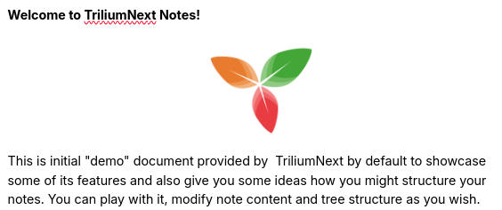
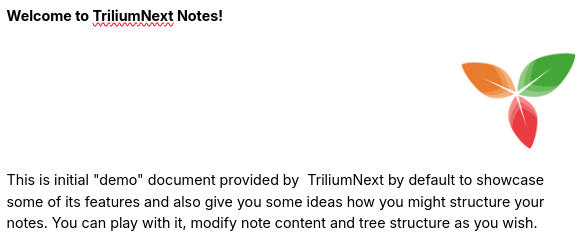
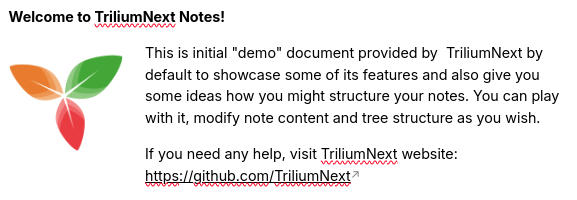

# 图片
Trilium 支持存储和显示图片。支持的格式有 PNG、JPEG、GIF、BMP、WebP、AVIF 和 SVG。

图片可以以笔记的[附件](../../Basic%20Concepts%20and%20Features/Notes/Attachments.md)形式上传，也可以作为独立的[笔记](../../Basic%20Concepts%20and%20Features/Navigation/Tree%20Concepts.md)放入[笔记树](../../Basic%20Concepts%20and%20Features/Navigation/Tree%20Concepts.md)中。其引用可以复制到文本笔记中，以便在文本本身中显示它。

## 上传图片

要将图片添加到笔记中：

*   只需将其从文件资源管理器拖放到 Trilium 内的笔记编辑器中，图片就会被上传。
*   或者，在<a class="reference-link" href="Formatting%20toolbar.md">格式工具栏</a>中，按 _附加文件_ 按钮并选择 _图片_。
*   在<a class="reference-link" href="../../Installation%20%26%20Setup/Mobile%20Frontend.md">移动端前端</a>上，同一菜单还提供 _相机_，可拍照并插入。
*   你也可以从网页复制并粘贴图片（见下文小节）。

> [!TIP]
> 若要链接图片而不是显示它，请通过 _附加文件_ 按钮使用 _以链接形式附加文件_ 来附加它。参见<a class="reference-link" href="../../Basic%20Concepts%20and%20Features/Notes/Attachments.md">附件</a>。

## 剪贴板与图片自动下载

Trilium 对复制到剪贴板和从剪贴板粘贴的图片有特殊处理。

*   对于文本和图片的混合内容，图片会由服务器（或桌面应用，取决于所使用的环境）自动下载。
    *   这意味着图片必须是可公开访问的，并且能从 Trilium 运行的任何位置访问到。无法访问的图片最终会显示为损坏的图片。
*   如果粘贴到 Trilium 的是单张图片，它会优先使用剪贴板中的图片。这使得可以复制 Trilium 原本无法访问的图片，例如 Google Chat、Slack 等。
*   当从 Trilium 复制带图片的文本并粘贴到其他应用（如 Microsoft Word 或 LibreOffice Writer）时，图片会被保留。

图片自动下载默认启用，可在<a class="reference-link" href="../../Basic%20Concepts%20and%20Features/UI%20Elements/Options.md">选项</a> → _媒体_ → _自动下载图片_ 中切换。

## 配置图片

点击图片会显示一个包含多个选项的弹出窗口：  

### 对齐

弹出窗口的第一个按钮 _图片位置_ 显示图片当前位置的图标。它会打开一个菜单，按文字环绕图片的方式对位置进行分组：

| 图标 | 选项 | 预览 | 描述 |
| --- | --- | --- | --- |
|  | _行内_ |  | 图片像一个大字符一样位于段落内，并随其周围的文本一起移动。使用拖放或剪切粘贴来移动它。 |
|  | _断开文本_ → _左对齐_、_居中对齐_ 或 _右对齐_ |   | 图片单独显示在一行，位于左侧、居中或右侧；文本在其上方和下方继续，但不在其旁边。 |
|  | _环绕文本_ → _左对齐_ 或 _右对齐_ |  | 图片显示在左侧或右侧，文本在其旁边流动。 |

### 在图片上绘制

要在图片上绘制或书写，请按其工具栏上的  _将图片转换为绘图画布_ 按钮。图片会变成一个绘图画布，完整显示图片并锁定在固定位置。参见<a class="reference-link" href="Include%20Note.md">包含笔记</a>的绘图画布小节。

## 压缩

由于 Trilium 并非真正用作图片数据的主要存储，它会在将上传的图片存储到数据库之前尝试压缩和调整尺寸（使用相当激进的设置）。因此你可能会注意到一些质量下降。基本质量设置可在<a class="reference-link" href="../../Basic%20Concepts%20and%20Features/UI%20Elements/Options.md">选项</a> → _媒体_ 中找到。

如果你想以原始分辨率保存图片，建议将其作为附件保存到笔记中（查找<a class="reference-link" href="../../Basic%20Concepts%20and%20Features/UI%20Elements/Note%20menu.md">笔记菜单</a> → _导入文件_ 中的上下文菜单）。

## 并排对齐图片

通常有两种方式并排显示图片：

*   如果它们大小大致相同，只需按照上面的对齐小节将两张图片设为行内。图片可以拖放到同一行上。
*   如果它们大小不同，请创建一个边框不可见的[表格](Tables.md)。