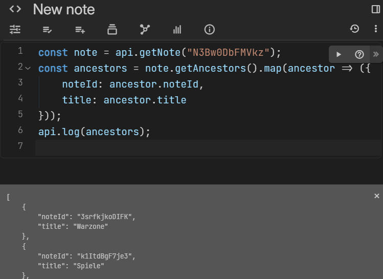

# 日志记录
前端和后端笔记都可以记录日志消息用于调试。

## 通过 `api.log` 进行 UI 日志记录

<figure class="image image-style-align-center image_resized" style="width:57.74%;"></figure>

API 日志功能与脚本编辑器集成，会显示所有通过 `api.log` 记录的消息。这适用于后端和前端脚本。

在执行使用 `api.log` 的脚本后，API 日志面板会出现在笔记底部（包括在<a class="reference-link" href="../Basic%20Concepts%20and%20Features/Navigation/Quick%20edit.md">快速编辑</a>中）。可以通过点击面板右上角的关闭按钮暂时关闭它。

除了字符串之外，还可以传入对象，此时如果可能的话会进行格式化显示（例如不支持递归对象）。

## 控制台日志记录

对于用户不直接可见的日志，也可以使用标准的 `console.log`。

*   对于前端脚本，日志将显示在开发者工具（也称为检查）中。
*   对于后端脚本，日志将在运行时显示在服务器输出中，但**不会**显示在<a class="reference-link" href="../Troubleshooting/Error%20logs/Backend%20(server)%20logs.md">后端（服务器）日志</a>中。